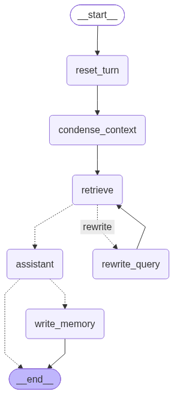

<p align="center">
  
</p>

<h1 align="center">AIst</h1>

<p align="center">
  <a href="https://github.com/coder-smookki/GSP-Project-AIst/releases/latest"></a>
  
  
  <br>
  
  
  
  
  
  
  
  
  
  <a href="#быстрый-старт"></a>
  <br>
  <a href="#форматирование-и-стиль"></a>
  <a href="#тестирование"></a>
  <a href="#лицензия"></a>
</p>

<p align="center">
  ИИ-поиск по корпоративной базе знаний (регламенты ИСМ.СМОЗиОБТ) с адаптивным RAG: ассистент разбирает вопрос на подзапросы, ищет по базе гибридным поиском (dense + BM25 + RRF) с переоценкой кросс-энкодером и отвечает со ссылками на пункты регламента, а если ответа в базе нет - честно отказывает. Полностью on-premise: Chainlit → Aegra/LangGraph → Ollama → Postgres, векторный слой - Qdrant
</p>

<p align="center">
  <a href="https://github.com/coder-smookki/GSP-Project-AIst/releases/latest"><b>Релизы</b></a> ·
  <a href="docs/DEPLOY.md"><b>Запуск и эксплуатация</b></a> ·
  <a href="docs/ARCHITECTURE.md"><b>Архитектура</b></a> ·
  <a href="docs/BENCHMARK.md"><b>Замер качества</b></a>
</p>

Кейс компании «Газстройпром», команда AIst.

<p align="center">
  
</p>

## Быстрый старт

Полное руководство по запуску и эксплуатации - [docs/DEPLOY.md](docs/DEPLOY.md).

```sh
cd deploy
cp .env.example .env                # заполнить KB_EMAIL / KB_PASSWORD
# Слои qdrant и оркестрации (orf) подключены к корневому compose через include,
# поэтому одной командой поднимается весь стенд (интерфейс + агент + индекс):
docker compose up -d --build
open http://localhost:8000          # интерфейс: admin / admin
```

Наблюдаемость (OpenLIT, опционально):

```sh
cd deploy
echo 'OTLP_ENDPOINT=http://openlit:4318' >> .env
docker compose -f docker-compose.observability.yml --profile obs up -d --remove-orphans
open http://localhost:3000
```

## Резюме

**Что работает.** Связка проверена на целевой машине целиком: Chainlit → Aegra/LangGraph → Ollama → Qdrant и Postgres. Вопрос проходит путь «планирование → параллельный поиск по подзапросам → сборка контекста → ответ со ссылками на пункты регламента», панель источников открывается до первого токена, диалог переживает перезапуск контейнеров. Проверка одной командой: `bash scripts/verify.sh --full`.

**Итоговая конфигурация** (M5 Pro 48 ГБ):

```
LLM_MODEL="gemma4:26b-nvfp4"          # закрывает обе роли: ответ и планирование
EMBEDDING_MODEL="qwen3-embedding:4b"  # 2560 измерений
QDRANT_COLLECTION="aist_chunks"       # имя АЛИАСА, поколения = <алиас>_v1, _v2
RETRIEVAL_TOP_K=5
RETRIEVAL_PREFETCH=20
RETRIEVAL_RRF_K=40
RETRIEVAL_MIN_RELEVANCE=0.45
RERANK_ENABLED=1
AEGRA_API_TOKEN=<обязателен>       # без него агент не отвечает никому
ADMIN_PASSWORD=<обязателен>        # стек не поднимется с пустым
```

| Показатель | Значение |
| --- | --- |
| hit@1 / hit@3 / hit@5 | **0,793 / 0,917 / 0,926** (96/121, 111/121, 112/121) |
| MRR | **0,851** |
| Ответ не найден в контексте | 9 из 121 (7,4 %) |
| Честный отказ | на расширенном наборе не переснимался; прежде 10 из 10, ложных нет |
| Медиана ответа | **9-12 с** (310-388 ответов в час) |
| Честный отказ по времени | **0,4 с** |
| Поиск | медиана 268 мс, p95 308 мс |
| Индексация 20 документов | 32 с; повторная 1,76 с |
| Автотестов | 654, линтер чист |

**Главный урок проекта.** Смена модели ответа дала больше, чем весь перебор параметров. При этом выбор модели по одному критерию оказался ошибкой: `gpt-oss:20b` давала безупречный честный отказ (10 из 10), но ломала декомпозицию запроса (1 из 6) - структурированный вывод возвращал пустоту, план молча подменялся исходным вопросом, и мультиагентный разбор составных вопросов не работал вовсе. `gemma4:26b-nvfp4` закрывает обе способности и вдвое быстрее. Подробности - в «Замер качества».

**Ограничения, о которых честно.** Качество измерено на 20 документах выгрузки, на полном корпусе требует подтверждения. Таблицы в выгрузке приходят без табличной разметки, поэтому разбираются хуже связного текста. Система не знает об отмене регламента. Эталонный набор составлен нами по корпусу, а реальные формулировки сотрудников почти всегда отличаются.

Отдельно про **встроенные ограничения моделей**. Открытые модели общего назначения
несут фильтры безопасности от своих авторов, и на промышленном корпусе это задевает
законные рабочие вопросы: газоопасные и огневые работы, взрывчатые материалы,
допуски к опасным операциям. В нашем корпусе такие формулировки встречаются 214 раз;
на текущем наборе все подобные вопросы модель отработала (4 из 4), то есть риск
реальный, но пока не проявился. Если на полном корпусе отказ по теме появится, он
лечится не переписыванием подсказки, а сменой модели: на Hugging Face есть версии тех
же моделей со снятыми фильтрами (`abliterated`, `uncensored`), они ставятся тем же
`ollama pull` из локального файла и не меняют ни строки кода - модель задаётся
переменной `LLM_MODEL`. Лицензии проверять отдельно: производные наследуют лицензию
исходной модели, а нам подходят только Apache-2.0 / MIT.

## Интерфейс

Вход по паролю, история диалогов и список чатов - штатный слой данных Chainlit поверх того же Postgres, что у чекпоинтера агента. Идентификатор треда агента совпадает с идентификатором диалога, поэтому после перезагрузки страницы диалог продолжается с того же места без хранения соответствий.

- шесть стартовых подсказок по темам реального корпуса;
- выбор **областей знаний** (пожарная безопасность, охрана труда, ГО и ЧС, промышленная и производственная безопасность, работы повышенной опасности); пустой выбор означает поиск по всей базе;
- панель «Источники» открывается до первого токена ответа;
- подсказки следующего вопроса собираются из номеров пунктов найденных чанков, без второго вызова модели;
- самостоятельная регистрация выключена: `ALLOW_SELF_REGISTRATION=1` открывает её только для отладки, а штатный путь - код приглашения `REGISTRATION_CODE` (`gui/register.py`): администратор выдаёт код человеку отдельно, без него страница `/register` отдаёт 404.

## Доступ и изоляция пользователей

Браузер к агенту не ходит - ходит только интерфейс. Он проверяет человека по логину и
паролю, а агенту предъявляет токен (`AEGRA_API_TOKEN`) и заголовок `X-Aist-User` с именем
пользователя. Личность подставляет сервер, поэтому подменить её клиент не может; именно
она задаёт пространство долгосрочной памяти `("memories", user_id)`.

Было иначе, и это стоит назвать прямо. Aegra по умолчанию работает без аутентификации:
все запросы получают личность `anonymous`, а `user_id` брался из тела запроса, потому что
сервер подставляет свой только через `setdefault`. То есть любой, кто дотянулся до порта,
мог назваться кем угодно и прочитать чужую память, а `DELETE /threads/{id}` сверял владельца
с той же `anonymous` и позволял удалить чужой диалог. Закрыто в `deploy/auth.py`:

- нет токена в запросе - нет доступа, никакого отката к общей личности;
- **токен не настроен на сервере - сервис не пускает никого**, и в логе печатается, что
  сделать. Молчаливое возвращение к `anonymous` было бы худшим из вариантов;
- имя пользователя проверяется по узкому набору символов: оно становится частью
  пространства имён хранилища, и разделители путей внутрь не пропускаются;
- ресурсы помечаются владельцем, выборки тем же условием ограничиваются.

Проверяется машинно: `bash scripts/verify.sh --full` отдельным шагом убеждается, что агент
отвечает отказом без токена. Шаг нужен потому, что забытая пересборка образа откатывает
защиту молча - Aegra просто не найдёт файл аутентификации и вернётся к `anonymous`.

Пароль администратора интерфейса обязателен: стек не поднимется с пустым значением, а
пустой пароль больше не открывает вход (раньше при заданном имени и незаданном пароле
пустая строка совпадала сама с собой).

## Аудит 19.08.2026

Разбор шестью независимыми ракурсами с проверкой каждой находки на опровержение:
найдено 66, подтверждено 43, закрыто 18. Полный отчёт - [docs/audit_2026-08-19.md](docs/audit_2026-08-19.md).

Главное, что он нашёл: **ответы копили источники предыдущих вопросов**. Узел сброса
возвращал пустые списки в каналы с reducer-сумматором, а `current + []` это `current` -
сброса не происходило вовсе. Со второго вопроса в одном диалоге большую часть контекста
занимали выдержки к предыдущим. Тем же каналом ломался честный отказ: одна давняя авария
индекса навсегда подменяла «в базе знаний информации нет» сообщением о недоступности поиска.

Замеры этого показать не могли: `eval/runners.py` берёт новый `thread_id` на каждый
вопрос, то есть всегда измеряет первый ход, а интерфейс держит один тред на весь диалог.
**Замер, который не воспроизводит способ работы пользователя, показывает исправную систему
независимо от того, исправна ли она.** Регрессия закрыта тестом на настоящем графе с одним
тредом.

Одна находка отклонена замером, а не рассуждением: идентификаторы точек якобы схлопываются
на одинаковых текстах - на реальном корпусе 1475 фрагментов дали 1475 уникальных
идентификаторов, и намеренное решение команды осталось как было.

## Каталог базы знаний

Интерфейсу нужны две вещи, которых нет в протоколе агента, - и обе отдаёт сама Aegra
маршрутами из `deploy/content_app.py`:

| Маршрут | Что отдаёт |
| --- | --- |
| `GET /knowledge/tree` | Дерево «область знаний -> документ -> тип раздела» |
| `GET /knowledge/documents/{doc_code}` | Документ целиком, фрагментами по порядку чтения |

Дерево обязательно по ТЗ, и теперь оно обеспечено на всю глубину: поиск фильтрует по всем
трём уровням (`area`, `doc_code`, `section_type`), причём все три поля проиндексированы в
Qdrant как `KEYWORD` - отбор идёт по индексу, а не перебором.

Оба ответа собираются **из индекса**, а не из исходных файлов. Так сделано намеренно:
корпус в контейнеры приложения не смонтирован, путей к файлам в индексе нет, а у документов
из API их нет вовсе. Индекс же хранит и `order_no`, по которому документ восстанавливается
в порядке чтения. Дерево кешируется: состав базы меняется только при переиндексации.

## Адаптивность

Пять механизмов. Каждый включён или выключен по результату замера, а не по названию кейса, и для каждого ниже сказано, что именно он покупает и чего стоит.

**Порог релевантности** (`RETRIEVAL_MIN_RELEVANCE`, включён; в деплое 0.45). Если лучшее попадание слабее порога, выдача считается пустой и ассистент отвечает «В базе знаний информации нет». Без порога честный отказ механически недостижим: поиск всегда возвращает заданное число фрагментов, и на вопрос вне базы модель получила бы несколько настоящих пунктов регламента.

На золотом наборе порог даёт **5 верных отказов из 5** на вопросах вне области (НДС, отпуск, сброс пароля) и ни одного ложного. Но у него есть чёткая граница применимости: он отвечает на вопрос «есть ли в базе ответ вообще» и сравнивается только с лучшим попаданием. Отсеивать им отдельные фрагменты внутри выдачи нельзя - там счета почти плоские, релевантные лежат в 0,595-0,742, посторонние в 0,486-0,649, диапазоны пересекаются, и значение 0,595 встречается одновременно как ответ и как шум.

**Коррекция запроса.** При пустой выдаче ветка-агент переформулирует запрос языком регламента и повторяет поиск (ReAct-петля в `agent/search_agent.py`, до `retrieval_branch_retries + 1` обращений на ветку). Вызывается только при неудаче, поэтому средняя цена по всем запросам близка к нулю.

**Переоценка кросс-энкодером** (`RERANK_ENABLED`). Даёт +17 пунктов hit@1 (0,561 →
0,732 при 10 кандидатах) за +175 мс - поэтому **включена по умолчанию**
(`RERANK_ENABLED=1`). Считается вне контейнера: на хосте (MPS, `deploy/rerank_server.py`)
или в отдельном GPU-контейнере (`docker-compose.reranker.yml`), контейнер aegra
ходит к ним по HTTP (`RERANK_ENDPOINT`), офлайн. Без переоценки честный отказ работает как и с ней:
10 из 10 вопросов без ответа получают отказ. Таблица замеров и расчёты на CPU/docker -
в `docs/RETRIEVE.md` (раздел 8).

**Сверка чисел** (`VERIFY_NUMBERS`, включена). Детерминированная защита от худшего вида ошибки. Замер на qwen3:8b: на вопрос о сроке регистрации микротравмы модель ответила «в течение 24 часов **[1]**» - такого срока в корпусе нет вовсе, а ответ снабжён ссылкой на источник и потому неотличим от требования регламента. Ни грейдер, ни усиление правил промпта таких ответов не убрали: на qwen3:8b доля верных отказов оставалась 6 из 10 во всех трёх режимах. На демо-машине с `gpt-oss:20b` доля верных отказов - **10 из 10**, то есть проблема закрыта самой моделью. Проверка при этом остаётся включённой как страховка: из ответа берутся пары «число + единица» и сверяются с контекстом, неподтверждённые помечаются припиской. Пара, а не голое число: цифры 5 и 10 стоят в номерах пунктов почти каждого документа. Ложных срабатываний 1 на 10 числовых вопросов, и это предупреждение, а не отказ.

**Грейдер релевантности** (`GRADING_ENABLED`, выключен). Реализован и замерен на полном пути ответа: **не меняет ничего**. На qwen3:8b доля верных отказов одинакова с ним и без него - 6 из 10, причём выдумки те же самые, включая «в течение 24 часов».

Причина видна из устройства выдачи. Внедоменные вопросы отсекает порог **ещё до грейдера**: поиск возвращает ноль фрагментов, и модель не вызывается вовсе - эти отказы делает порог, не он. А на вопросах, которые порог пропускает, грейдер отказа не даёт: на «кто выдаёт наряд-допуск» он оставил 3 фрагмента из 5, на «как часто проводится СОУТ» - 1 из 5. Зато с отсевом «частично относящихся» он устойчиво терял ответ в 2 случаях из 4: нужный фрагмент оба раза был помечен «частично», то есть искомое живёт именно в отбрасываемой категории. Поэтому `GRADING_KEEP_PARTIAL=1` - если грейдинг всё же включат, он не должен резать ответы.

Оставлен как заготовка под другой корпус или более сильную служебную модель: методика и тесты для повторного замера готовы, а сам код разбирает три ловушки структурированного вывода Ollama (перечисление вместо строки, длина массива, компактная схема) - они описаны в [grading.py](agent/grading.py).

Отдельный вывод: **число фрагментов нельзя резать вслепую** - `RETRIEVAL_TOP_K=5`
безопасен, до 4 опускать можно (лучше с переоценкой), до 3 - ни в каком
сочетании: нужный фрагмент живёт на позициях 4-5. Таблица замеров - в `docs/RETRIEVE.md`
(раздел 9).

## Замер качества

Качество меряется на золотом наборе, а не точечными прогонами: без постоянного набора вопросов нельзя узнать, стало ли лучше после смены модели, границ чанков или числа фрагментов в контексте.

Инструменты, метрики и история всех прогонов - в [docs/BENCHMARK.md](docs/BENCHMARK.md); ниже - команды быстрого доступа:

```sh
uv run eval run --with-answers                      # качество base на золотом наборе
uv run eval ab --variants variants.json --with-answers   # A/B-сравнение вариантов
uv run eval report                                  # обновить docs/BENCHMARK.md
uv run eval cache list                              # какие результаты уже сняты
```

Набор - [tests/fixtures/golden/questions.json](tests/fixtures/golden/questions.json): **121 вопрос с известным ответом** (все 20 документов; 43 числовых, 35 процедурных, 16 фактических, 14 об ответственности, 13 перечней) и **10 вопросов без ответа**. Каждый вопрос сопровождается дословной цитатой из документа - она и есть эталон: фрагмент считается попаданием, если содержит её текст. Проверяется не формулировка модели, а то, попали ли нужные сведения в контекст вообще.

Вопросы без ответа делятся надвое. Пять явно посторонних (НДС, отпуск, сброс пароля) отсекаются порогом близости и потому лёгкие. Ценность дают вторые пять - звучащие совершенно уместно, с лексикой корпуса, но без ответа в этих документах: гарантии при подклассе условий труда 3.2, срок регистрации микротравмы, нормы выдачи СИЗ для электрогазосварщика. Поиск на них обязательно что-то вернёт, и именно там система склонна выдумывать. Показателен случай микротравмы: корпус её определяет и ссылается на положение «Организация расследования микротравм», которого в корпусе нет.

Целостность набора закреплена тестами ([tests/eval/test_golden_set.py](tests/eval/test_golden_set.py)): каждая цитата сверяется с корпусом, поэтому эталон не разойдётся с данными незаметно.

### Текущие цифры

Снято на целевой машине (M5 Pro, 48 ГБ), `gemma4:26b-nvfp4` +
`qwen3-embedding:4b`, корпус 1475 фрагментов, конфигурация из «Резюме»,
**на расширенном золотом наборе (121 отвечаемый + 10 без ответа) и новом
пайплайне поиска**:

| Показатель | Значение |
| --- | --- |
| hit@1 / hit@3 / hit@5 | 0,793 / 0,917 / 0,926 (96/121, 111/121, 112/121) |
| MRR | 0,851 |
| Ответ не дошёл до контекста | 9 из 121 (not_found 0,074) |
| Честный отказ | в этом прогоне не снимался (`refusal_rate —`); прежний замер на наборе без ответа: 10 из 10, ложных нет |
| Поиск, медиана | 268 мс (p95 - 308 мс) |

Цифры не сравнимы напрямую с прежними 0,837/0,943: те сняты на старом
наборе из 41 вопроса. Расширенный набор покрывает все 20 документов и пять
типов вопросов, поэтому абсолютные значения ниже, а оценка - честнее.
Полные таблицы и история всех прогонов - в `docs/BENCHMARK.md`.

### Что проверено и не подтвердилось

Три гипотезы закрыты замером, а не мнением, - это экономит время следующему,
кто до них додумается.

**Расширение воронки** (`prefetch` 10 → 20/30). Значимо меняется только задержка
(p=0,000); различия в качестве в пределах шума. При этом `prefetch=20` всё же
выбран: при `top_k=5` рабочая метрика - hit@5 и «не найдено», а не hit@3, потому
что модель читает все пять фрагментов. Полнота важнее порядка внутри контекста.

**Инструкция к запросу** для `qwen3-embedding`. Карточка модели обещает 1-5 %
прироста, замер дал разницу в один вопрос в обе стороны: hit@3/5 просели с 0,943
до 0,927, честный отказ вырос с 0,900 до 1,000. Обе разницы - один вопрос,
значимыми быть не могут. Оставлено выключенным; значение-образец лежит в
`deploy/.env.example`.

**Грейдер релевантности** (`GRADING_ENABLED`). Замерен на полном пути ответа:
не меняет ничего. Внедоменные вопросы отсекает порог ещё до него, а на доменных
он либо теряет ответ, либо не трогает выдачу.

### Сравнение эмбеддинговых моделей

Полный A/B-матрица прогнана на золотом наборе (41 ответ находимых вопросов + 10 без ответа), 2 эмбеддеры × 2 LLM × 2 support × {rerank on/off} × {grade on/off} = **32 варианта**. Кэш результатов - в `eval/results/`; сверка - `uv run eval ab --variants eval/variants_{bge,qwen4b}.json --with-answers`.

| Показатель | bge-m3:567m (1024 dim) | qwen3-embedding:4b (2560 dim) | Выбор |
| --- | --- | --- | --- |
| hit@1, rerank on | 0,732 | **0,756** (+4 вопроса) | qwen4b |
| hit@5, rerank on | 0,854 | 0,854 | - |
| MRR, rerank on | 0,776 | **0,799** | qwen4b |
| hit@1, rerank off | 0,561 | **0,634** (+7 вопросов) | qwen4b |
| MRR, rerank off | 0,647 | **0,690** | qwen4b |
| Ответ не найден, rerank on | 9 | 9 | - |
| latency median, rerank on | 0,29 с | 0,32 с | bge чуть быстрее |
| latency median, rerank off | 0,13 с | 0,16 с | bge чуть быстрее |

Матрица снята на прежнем наборе из 41 вопроса и прежней воронке
(`RETRIEVAL_PREFETCH=10`), поэтому её лучшие 0,756 ниже итоговых 0,837 на том
же наборе: те получены после расширения воронки до 20. Сравнивать столбцы
между собой можно, с цифрами других разделов - нет.

**Переоценка** - критична для обеих моделей: без неё hit@1 падает ≈17 пунктов. **Грейдинг** - не влияет ни на качество, ни на latency (подтверждено A/B: p=1,000 по всем метрикам). **LLM и support модель** - не влияют на retrieval, только на ответы.

**Итог**: `qwen3-embedding:4b` лучше `bge-m3` во всех точках качества при цене +20-30 мс на поиск. Для включения:

```sh
# .env
EMBEDDING_MODEL="qwen3-embedding:4b"
# Qdrant: переключить алиас aist_chunks → aist_chunks_v2
```

### Что эти цифры значат

**Хорошее.** Порог близости работает безупречно на своей задаче: все вопросы вне области знаний получают честный отказ, ни одного ложного отказа на настоящих вопросах.

**Раньше было плохо, и это закрыто перезамером.** На прежней модели (qwen3:8b) вопросы, которые звучат уместно, но ответа в корпусе не имеют, давали **уверенную выдумку со ссылкой на источник**:

> «Регистрация микротравмы проводится в течение 24 часов с момента её получения **[1]**»

Числа «24 часа» в корпусе нет вовсе. Ссылка [1] вела на реальный фрагмент - просто этого срока в нём не написано, и проверить это пользователь не мог. На той машине проверили три способа лечения, **не помог ни один**: без грейдера 6 верных отказов из 10, с грейдером 6 из 10, с усиленными правилами промпта те же 6 из 10. Это был предел послушности qwen3:8b, а не изъян архитектуры. Поэтому защита вынесена наружу - детерминированная сверка чисел (`VERIFY_NUMBERS`); она остаётся включённой как страховка на случай возврата к слабой модели.

На итоговой модели те же вопросы дают **10 из 10 честных отказов**, выдумки нет: проблема была в модели, а не в архитектуре.

### Но «взять модель побольше» - тоже неверный вывод

Выбирать модель по одному критерию оказалось ошибкой, и это стоит помнить.

| Модель | Честный отказ | Декомпозиция запроса |
| --- | --- | --- |
| `gpt-oss:20b` | 10 из 10 | **1 из 6** |
| `gemma4:e2b-mlx` | 6 из 10 | 6 из 6 |
| **`gemma4:26b-nvfp4`** | **10 из 10** | **6 из 6** |

`gpt-oss:20b`, лучшая по честности, ломала декомпозицию: `with_structured_output`
возвращал пустой ответ, разбор падал с `Invalid json output:` без содержимого, и
код молча откатывался на исходный вопрос. То есть мультиагентный разбор составных
вопросов **не работал вовсе**, включая роутер - «Привет!» уходило в режим `kb` и
запускало полный поиск. Нашлось по трассировке OpenLIT.

Причина: у gpt-oss размышления управляются через `reasoning_effort`, а передавался
`reasoning=False`. Закрыто запасным путём в `agent/planner.py`: при сбое
структурированного вывода план запрашивается обычным сообщением, JSON вырезается
из текста. Проверять - `uv run python scripts/check_planner.py` (6 случаев).

**Вывод:** каждую способность, которая используется в решении, надо проверять
отдельным замером. Итоговая модель закрывает обе роли, поэтому второй слот модели
не занят вовсе.

**Что осталось сделать.**

- [#4](https://github.com/coder-smookki/GSP-Project-AIst/issues/4) - ветвление диалога; помечено автором как необязательное и в спецификации не значится.

Переоценка вынесена из образа aegra: в dev её считает хост-сервис на MPS
(`deploy/rerank_server.py`, `RERANK_ENDPOINT=http://host.docker.internal:8899`),
в prod - отдельный GPU-контейнер `docker-compose.reranker.yml` (CUDA, веса модели
запечены в его образ при сборке). См. `docs/RETRIEVE.md` (раздел 8) и
`docs/DEPLOY.md`. При смене `RERANK_MODEL` пересобирается образ реранкера.

## Замеры на живом стенде

Итоговые цифры сняты 19.08.2026 на целевой машине (M5 Pro, 48 ГБ), `gemma4:26b-nvfp4`.
Приведены два независимых прогона: генерация недетерминирована, и разброс показан честно.

| Вид вопроса | Прогон 1 | Прогон 2 | Длина ответа |
| --- | --- | --- | --- |
| Честный отказ | **0,4 с** | **0,4 с** | 29 знаков |
| Числовой (срок, периодичность) | 5,0 с | 4,5 с | 150 знаков |
| Длинная процедура | 8,3 с | 11,1 с | 700-1 300 знаков |
| Короткий факт | 10,2 с | 12,1 с | 350-430 знаков |
| Перечень требований | 13,2 с | 15,8 с | 1 400-1 900 знаков |
| **Медиана** | **9,3 с** | **11,6 с** | - |

**310-388 ответов в час**; для планирования берётся нижняя граница. Время определяется
длиной ответа, а не сложностью поиска: поиск везде около 0,32 с. Разброс между прогонами
объясняется тем же - на один и тот же вопрос модель выдаёт то 700, то 1 300 знаков.

Одновременные обращения теперь **увеличивают** пропускную способность: 1 запрос - 5,3
ответа в минуту, 2 - 6,7, 4 - 6,8. Полка около 6,8: дальше упирается в саму модель.

### Смена модели дала больше, чем весь перебор параметров

| Конфигурация | hit@1 | Медиана ответа | Ответов в час |
| --- | --- | --- | --- |
| bge-m3, без переоценки | 0,561 | 9,7 с | 371 |
| bge-m3, с переоценкой | 0,732 | 14,7 с | 245 |
| qwen3-emb + `gpt-oss:20b` | 0,829 | 23,2 с | 155 |
| **qwen3-emb + `gemma4:26b`** | **0,837** | **9-12 с** | **310-388** |

Обмена «качество против скорости» в итоге не потребовалось. Он был настоящим, пока
отвечала `gpt-oss:20b`, и снялся сменой модели целиком.

### Ресурсы

ОЗУ около 17 ГБ из 48, диск ~19 ГБ с образами. Индексация 20 документов → 1475 фрагментов
за 32 с, повторный прогон на неизменившемся корпусе 1,76 с, индекс на диске 22 МБ.
Серверов не задействовано ни одного: весь стек на одной машине.

## Индексация корпуса

Выгрузка 20 статей раздела 44030 лежит в `tests/fixtures/corpus/`, поэтому
конвейер проверить **без доступа к API и без Qdrant**:

```sh
uv run python scripts/ingest.py --dry-run --source files
```

Полная индексация в новое поколение с переключением алиаса - в `docs/INGEST.md`
(флаги `--source/--corpus-dir/--section/--generation/--switch-alias/--full/
--limit/--dry-run/--qa-index/--verbose`, коды
выхода `0|1|2`, инкремент по хешу - повторный прогон без изменений **1,76 с** на
20 документах; алиас не переключается при ошибках). Быстрый старт стенда с
индексацией - в `docs/DEPLOY.md`.

## Структура проекта

Слои: `domain` (бизнес-правила) → `infrastructure` (адаптеры: LLM, поиск, настройки) → `agent` (граф LangGraph) → `gui` (Chainlit). Запуск - из `deploy`.

```text
agent/                          # граф: START→reset_turn→condense_context→plan→
                                #   (parallel search_agent)→finalize→assistant→write_memory
  graph.py                      #   узлы, промпты, обработка отказов модели, follow-ups
  state.py                      #   AgentState: messages, plan, branch_retrieved, retrieved…
  planner.py                    #   планировщик: режим chat/kb + декомпозиция на подзапросы
  search_agent.py               #   ветка-поиск: ReAct-сабграф с инструментом retrieve_kb
  events.py                     #   aist-конверт custom-событий (sources/followups/trace)
  grading.py                    #   отсев фрагментов моделью (выключен, см. замер внутри)
  numbers.py                    #   сверка чисел ответа с контекстом
  memory_gate.py                #   нужно ли вообще извлекать память из сообщения
  prompts.py                    #   все большие промпты агента в одном месте

domain/
  context/manager.py            #   суммаризация истории диалога
  memory/schema.py              #   модели долгосрочной памяти

infrastructure/
  config/                       #   settings.py, model_registry.py, composition_root.py
  llm/                          #   клиенты: openai_compat, ollama, llamacpp, vllm
  embeddings/                   #   эмбеддинги: openai_compat, ollama, llamacpp, vllm
  ingest/                       # офлайн-конвейер построения индекса
    models.py                   #   Atom, ParsedDocument, IngestChunk, идентификаторы точек
    patterns.py                 #   регулярки разбора регламентов (единая точка правды)
    html_parse.py               #   HTML статьи -> разделы и атомы
    docx_parse.py               #   .docx без внешних зависимостей (zipfile + re)
    deanon.py                   #   пофайловый словарь [ОРГАНИЗАЦИЯ_N] -> расшифровка
    chunker.py                  #   атомы -> чанки, breadcrumb вместо overlap
    areas.py                    #   предметные области знаний (в источнике их нет)
    incremental.py              #   сверка по хешу: что переиндексировать
    pipeline.py                 #   оркестрация прогона и отчёт
  retrieval/
    search.py                   #   протокол Search + формат Citation
    factory.py                  #   сборка поиска по настройкам (без тихого отката на заглушку)
    kb_client.py                #   HTTP-клиент базы знаний: вход, refresh, повторы
    source.py                   #   DataSource: ApiSource и FilesSource
    bm25.py                     #   опции серверного BM25 (одни для записи и запроса)
    store.py                    #   коллекция Qdrant, загрузка, уборка, поколения
    qdrant_search.py            #   гибридный поиск dense + BM25, слияние RRF, порог
    catalog.py                  #   каталог базы знаний из индекса (дерево и документы для GUI)
    rerank.py                   #   переоценка кросс-энкодером (включена, см. замер внутри)
    mock_search.py              #   синтетическая заглушка для отладки интерфейса
  observability/tracer.py       #   OpenTelemetry/OpenLIT
  orchestration/                 #   Prefect-обёртки: ingest_flow + serve (опционально)

gui/                            # Chainlit (:8000)
  chainlit_app.py               #   сообщения, стрим, панель источников, вход, настройки
  contract.py                   #   aist-конверт, цитирование
  stages.py                     #   этапы работы графа шагами Chainlit
  register.py                   #   саморегистрация по коду приглашения (REGISTRATION_CODE)
  db.py                         #   БД GUI (пользователи, схема истории диалогов)

eval/                           # харнесс измерения качества: run/ab/bench/tune/report/cache
  cli.py                        #   единый CLI `uv run eval ...`
  contracts.py                  #   протоколы Metric/Runner/Cache/StatTest/Reporter
  config.py                     #   Variant/RunConfig/Environment
  evaluate.py                   #   утилиты: normalize, chunk_contains, percentile
  variants.py                   #   сборка варианта (search/agent) из оверрайдов
  runners.py                    #   GoldenSetRunner + OperationalRunner
  golden.py                     #   золотой набор (questions.json) с валидацией
  metrics.py                    #   hit@k, MRR, not_found, refusal, latency, answer_chars
  stats.py                      #   A/B-тесты: МакНемар, Уилкоксон, пермутация
  compare.py                    #   матрица прогонов с кэшем и вердиктами
  benchmark.py                  #   операционный замер (латенси, нагрузка)
  cache.py                      #   детерминированный кэш результатов (eval/results)
  report.py                     #   генератор docs/BENCHMARK.md

deploy/                         # Docker: compose-слои, Dockerfile, Dockerfile.gui, aegra_entry, README
  docker-compose.yml (base: postgres+aegra+gui) → include qdrant/orc
  docker-compose.qdrant.yml         #   слой «база знаний» (Qdrant)
  docker-compose.reranker.yml       #   GPU-контейнер переоценки (prod, CUDA)
  docker-compose.orchestration.yml  #   слой Prefect (server+runner, см. docs/DEPLOY.md)
scripts/
  ingest.py                     #   индексация корпуса (поколения, алиас, инкрементальный режим)
  cli_chat.py, server_cli.py    #   отладка без интерфейса (агент и HTTP aegra)
tests/                          # pytest: fakes, test_agent, test_gui, test_infrastructure
  fixtures/corpus/              #   выгрузка 20 статей раздела 44030
  fixtures/golden/questions.json  # золотой набор: 121 вопрос с эталоном + 10 без ответа
docs/RETRIEVE.md                #   описание логики retrieve/search (промпты - agent/prompts.py)
docs/AGENT.md                   #   граф ассистента: узлы, память, события, промпты
docs/ARCHITECTURE.md            #   архитектура стенда и стек отображения
docs/BENCHMARK.md               #   харнесс измерения качества: метрики, A/B, история прогонов
docs/DEPLOY.md                  #   запуск и эксплуатация стенда
docs/GUI.md                     #   интерфейс Chainlit, контракт событий
docs/INGEST.md                  #   индексация корпуса и Prefect
docs/TESTS.md                   #   карта тестов, маркеры, как запускать
docs/demo/graph.png             #   схема графа (scripts/get_graph_visualization.py)

.github/workflows/ci.yml        #   CI: юнит-тесты на каждый PR
.githooks/pre-commit            #   автоформатирование ruff (scripts/setup_git_hooks.sh)
```

## Сборка и разработка

Проект собирается через [uv](https://docs.astral.sh/uv/) (pyproject + закоммиченный `uv.lock`):

```sh
uv sync --extra dev             # рантайм + dev-инструменты (pytest, ruff, chainlit)
uv run pytest -m "not integration"   # быстрые тесты без живых сервисов
uv run ruff check .
```

`--extra dev` обязателен - pytest/ruff лежат за этим extra. Версии фиксированы `uv.lock` (у всех и в CI одинаково); обновление - только через `uv lock`.

## Форматирование и стиль

Единый формат кода - **ruff==0.16.1** (зафиксирован в `uv.lock`, у всех байт-идентичный вывод).

**Автоматически при коммите.** Хук `.githooks/pre-commit` сам прогоняет `ruff format` по изменённым `.py` перед коммитом. Включить один раз:

```bash
bash scripts/setup_git_hooks.sh     # git config core.hooksPath .githooks
```

**Ручная проверка:**

```bash
uv run ruff format --check .        # формат
uv run ruff check .                 # линт (E/F/I/UP/B/SIM/ASYNC/RUF)
```

**VS Code** - расширение Ruff (`charliermarsh.ruff`) + `formatOnSave` из `.vscode/settings.json`; расширения рекомендованы в `.vscode/extensions.json`.

Настройки ruff (line-length 88, ignore-правила) - `pyproject.toml`, `[tool.ruff]`.

## Тестирование

Всего **654 теста** по маркерам (631 в быстром прогоне CI; `corpus`/`qdrant`/`llm`/`embeddings`/`integration`).
Быстрый прогон CI: `uv run pytest -m "not integration"`; полный - `pytest`
(нужен Ollama + Qdrant). Карта тестов, маркеры и локации - в `docs/TESTS.md`;
`llm`/`embeddings` пропускаются с подсказкой, если модель не скачана, чтобы
красный прогон не вводил в заблуждение.

## Текущее состояние проекта

**Готово (в `dev`):**

| Пункт | Заголовок | Что реализовано |
| --- | --- | --- |
| 3.2 | Процессы, порты, где живут | Стек поднят: Chainlit :8000 → Aegra :2026 → Ollama :11434, Postgres-чекпоинтер: `deploy/docker-compose.yml` |
| 5.1 | Состояние графа | `AgentState`: `messages`, `summary`, `plan`, `retrieved`, `followups` - `agent/state.py` |
| 5.2 | Кастомные события: конверт и транспорт | aist-конверт v1 (trace/sources/related/followups), вещание в stream + state: `agent/events.py`, `gui/chainlit_app.py` |
| 5.3 | Схема цитаты | `Citation`/`to_citation` по полям (n, doc_code, doc_title, clause, section_no, section_title, chunk_id, score, snippet, text, url): `infrastructure/retrieval/search.py` |
| 7.1 | Профили моделей | Слоты fast/quality (D-27): `LLM_SUPPORT_MODEL` + реестр `infrastructure/config/model_registry.py` |
| 9.3 | Наблюдаемость: расщепление по лицензиям | OpenLIT/OTLP только в overlay-файле (obs), в базовом стеке нет: `deploy/docker-compose.observability.yml` |
| 9.4 | Оркестрация индексации Prefect (Apache-2.0) | UI `:4200` + deployment-воркер: `deploy/docker-compose.orchestration.yml`, `infrastructure/orchestration/` |
| 9.6 | Тесты графа без Ollama | MockSearch/FakeEmbedding, юнит-тесты: `tests/`, маркеры `llm`/`embeddings` |
| 13.2 | Демо-сценарий (частич.) | Панель источников до первого токена + follow-up из пунктов чанков: `gui/chainlit_app.py` |

Дополнительно: CI на PR (`pytest -m "not integration"` + ruff), ruff==0.16.1 + pre-commit hook, `uv.lock` закоммичен.

**Issues: закрыто 31 из 33.** Открыты две: #4 и #28 - обе про ветвление и новый
дизайн интерфейса, заказчиком не запрошены.

| Issue | Задача | Слой | Итог |
| --- | --- | --- | --- |
| ~~[#1](https://github.com/coder-smookki/GSP-Project-AIst/issues/1)~~ | ChatStarter presets | gui | готово |
| ~~[#2](https://github.com/coder-smookki/GSP-Project-AIst/issues/2)~~ | Персистентность диалогов | gui | готово |
| ~~[#3](https://github.com/coder-smookki/GSP-Project-AIst/issues/3)~~ | Мультичаты + именование | gui | готово |
| [#4](https://github.com/coder-smookki/GSP-Project-AIst/issues/4) | Fork + replay | gui | **открыт**, помечен автором как необязательный |
| ~~[#5](https://github.com/coder-smookki/GSP-Project-AIst/issues/5)~~ | Corrective RAG: грейдер + переписывание | agent | переписывание включено; грейдер реализован, замерен на полном пути ответа и выключен - не меняет ничего |
| ~~[#6](https://github.com/coder-smookki/GSP-Project-AIst/issues/6)~~ | Реранкер (`RERANK_ENABLED`) | retrieval | реализован, даёт +17 пунктов hit@1; включён, считается вне контейнера (хост MPS / GPU-контейнер, офлайн) |
| ~~[#7](https://github.com/coder-smookki/GSP-Project-AIst/issues/7)~~ | Дата/время для временных запросов | agent | готово |
| ~~[#8](https://github.com/coder-smookki/GSP-Project-AIst/issues/8)~~ | Search facade за протоколом `Search` | retrieval | готово |
| ~~[#9](https://github.com/coder-smookki/GSP-Project-AIst/issues/9)~~ | FilesSource | ingest | готово |
| ~~[#10](https://github.com/coder-smookki/GSP-Project-AIst/issues/10)~~ | ApiSource | ingest | готово |
| ~~[#11](https://github.com/coder-smookki/GSP-Project-AIst/issues/11)~~ | docx-парсер + чанкинг атомов | ingest | готово |
| ~~[#12](https://github.com/coder-smookki/GSP-Project-AIst/issues/12)~~ | Деанонимизация пофайловым словарём | ingest | готово |
| ~~[#13](https://github.com/coder-smookki/GSP-Project-AIst/issues/13)~~ | Qdrant: коллекция + payload + загрузка | retrieval | готово, проверено на живом сервере |
| ~~[#14](https://github.com/coder-smookki/GSP-Project-AIst/issues/14)~~ | Qdrant: гибридный поиск dense+BM25+RRF | retrieval | готово, проверено на живом сервере |
| ~~[#15](https://github.com/coder-smookki/GSP-Project-AIst/issues/15)~~ | Убрать авторегистрацию, закрыть смену пароля | gui | готово |
| ~~[#16](https://github.com/coder-smookki/GSP-Project-AIst/issues/16)~~ | Панель источников отставала на вызов модели | gui | готово |
| ~~[#17](https://github.com/coder-smookki/GSP-Project-AIst/issues/17)~~ | Корректность разбора документов | ingest | готово |
| ~~[#18](https://github.com/coder-smookki/GSP-Project-AIst/issues/18)~~ | Прогон связки целиком, три дефекта | всё | готово |
| ~~[#19](https://github.com/coder-smookki/GSP-Project-AIst/issues/19)~~ | Стек не поднимался: healthcheck Qdrant на bash-синтаксисе в dash | deploy | готово |
| ~~[#20](https://github.com/coder-smookki/GSP-Project-AIst/issues/20)~~ | Золотой набор и замер качества | всё | готово |
| ~~[#21](https://github.com/coder-smookki/GSP-Project-AIst/issues/21)~~ | Внутренние сервисы смотрели наружу, Aegra без аутентификации | deploy | готово |
| ~~[#22](https://github.com/coder-smookki/GSP-Project-AIst/issues/22)~~ | Ingest: SOLID-рефакторинг и вынос в сервис с Prefect | ingest | готово, пайплайн отдельным сервисом, Prefect UI на `:4200` для отладки и расписания |
| ~~[#24](https://github.com/coder-smookki/GSP-Project-AIst/issues/24)~~ | Часть сообщений пропадала при перезагрузке и переключении чатов | gui | готово |
| ~~[#26](https://github.com/coder-smookki/GSP-Project-AIst/issues/26)~~ | Неявный Corrective RAG, слабый контроль `write_memory` | agent | готово: узлы расщеплены, цикл коррекции задан явно рёбрами, запись в память закрыта воротами `agent/memory_gate.py`, объяснения вынесены в `docs/AGENT.md` |
| ~~[#29](https://github.com/coder-smookki/GSP-Project-AIst/issues/29)~~ | R&D: таблицы в документах | ingest | закрыт без внешнего конвертера: границы `w:tbl` размечаются на разборе, текст таблиц помечается блоком `td`, номера пунктов внутри таблиц считаются недостоверными. Ограничение осталось и названо в «Резюме» |
| ~~[#30](https://github.com/coder-smookki/GSP-Project-AIst/issues/30)~~ | R&D: мультиагентность | agent | готово, составной вопрос разбивается на подзапросы и ветки идут параллельно через `Send` |
| ~~[#31](https://github.com/coder-smookki/GSP-Project-AIst/issues/31)~~ | Бенчмарк отдельным модулем | eval | готово: модуль `eval/`, A/B со статистикой (`binomtest`/`wilcoxon`), кэш прогонов |
| ~~[#32](https://github.com/coder-smookki/GSP-Project-AIst/issues/32)~~ | Качественная документация | docs | готово: `docs/ARCHITECTURE.md` плюс восемь документов по слоям, README разгружен |
| ~~[#41](https://github.com/coder-smookki/GSP-Project-AIst/issues/41)~~ | Реранкер работал 15-20 с в контейнере демо-машины | deploy | готово: вынесен хост-сервисом рядом с Ollama, 15 с → 0,194 с |
| [#28](https://github.com/coder-smookki/GSP-Project-AIst/issues/28) | Кастомный дизайн интерфейса в стиле компании | gui | **открыт**, вне текущего объёма |
| ~~[#33](https://github.com/coder-smookki/GSP-Project-AIst/issues/33)~~ | Клиенты vLLM для генерации, эмбеддингов и переоценки | infra | готово, три слоя + отдельные адреса портов |
| ~~[#34](https://github.com/coder-smookki/GSP-Project-AIst/issues/34)~~ | Показ этапов выполнения графа | gui | готово, все пять узлов видны по ходу ответа |
| ~~[#46](https://github.com/coder-smookki/GSP-Project-AIst/issues/46)~~ | Ответ не стримился в режиме чата | gui | готово; причина оказалась не в описании - `should_stream` включался только для узлов поиска |

## Сторонние компоненты

Сведения о сторонних компонентах и их лицензиях - в [NOTICE.md](NOTICE.md).

Проверка зависимостей: почти все pip-зависимости имеют разрешающие лицензии
(Apache 2.0 / MIT / BSD / ISC / PSF / 0BSD). Единственная копилефт-лицензия -
`text-unidecode` (двойная **GPL v2+ ИЛИ Artistic**), требуется через
`prefect → python-slugify` и поставляется **только в образе оркестрации**
(`.[orchestration]`), а не в основном API и GUI; для перераспространения
выбирается Artistic License. У MPL-2.0 пакетов (`tqdm`, `certifi`) слабый
копилефт на уровне отдельных файлов.

Модели загружаются отдельно и в репозиторий не входят: `gemma4:26b-nvfp4` (ответ и
планирование), `qwen3-embedding:4b` и `bge-m3` (векторное представление текста),
`BAAI/bge-reranker-v2-m3` (переоценка кандидатов), `gpt-oss:20b` (прежняя модель ответа).
Каждая остаётся под лицензией своего автора.

Выгрузка 20 регламентов в `tests/fixtures/corpus/` и цитаты из неё в
`tests/fixtures/golden/questions.json` получены от организатора кейса и принадлежат
их правообладателю.

## Команда

Команда AIst:

| Участник | GitHub |
|---|---|
| Ильин Кирилл | [@coder-smookki](https://github.com/coder-smookki) |
| Пьянков Михаил | [@Piankov-Michail](https://github.com/Piankov-Michail) |

## Лицензия

© 2026 Ильин Кирилл Русланович, Пьянков Михаил. Все права защищены.

«AIst» распространяется под проприетарной лицензией, полный текст - в [LICENSE](LICENSE). Коротко:

- можно смотреть код на GitHub и запускать опубликованные сборки только для личного ознакомления
- нельзя использовать решение в коммерции и в собственных целях, копировать, изменять, распространять, переносить код в другие проекты и обучать на нём модели без письменного разрешения правообладателей
- условия действуют бессрочно, весь срок действия исключительного права
- сторонние библиотеки, исходные веса моделей и сервисные образы остаются под своими лицензиями (MIT, Apache-2.0 и другими, см. раздел «Сторонние компоненты» и [NOTICE.md](NOTICE.md)); выгрузка регламентов организатора кейса принадлежит её правообладателю

Для разрешения на использование - [@coder-smookki](https://github.com/coder-smookki) или [@Piankov-Michail](https://github.com/Piankov-Michail).
