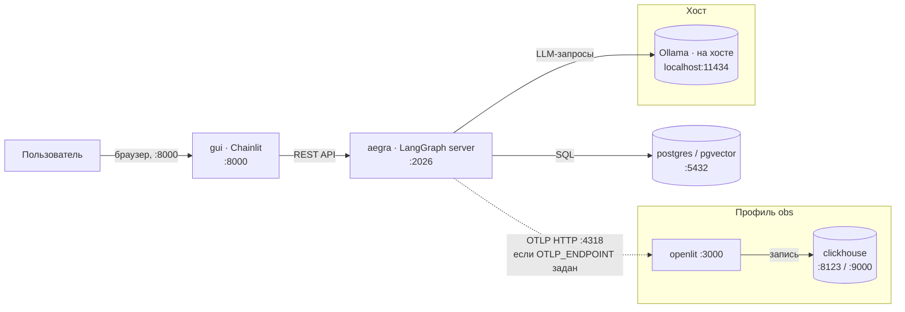
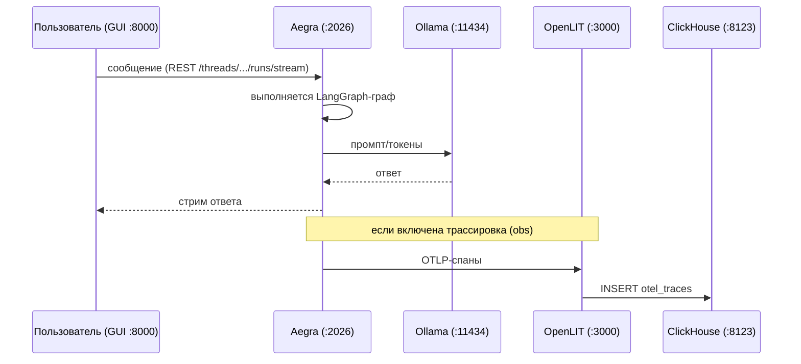

# Aegra — запуск и эксплуатация

Docker-стек AI-агента. Три базовых сервиса: `postgres`, `aegra`, `gui`. Опционально поднимается наблюдаемость LLM: `openlit` + `clickhouse` (compose-профиль `obs`).

## Архитектура





## Состав сервисов

| Сервис      | Роль                                                        | Порты (host)              | Где |
| ----------- | ----------------------------------------------------------- | -------------------------- | --- |
| `postgres`  | Postgres + pgvector: чекпоинтеры, состояние, БД GUI          | `5432`                     | base |
| `aegra`     | LangGraph runtime: REST API графа                            | `2026`                     | base |
| `gui`       | Chainlit-интерфейс для браузера                              | `8000`                     | base |
| `openlit`   | LLM-наблюдаемость: приём OTLP, UI трасс                     | `3000`, `4317` (gRPC), `4318` (HTTP) | obs |
| `clickhouse`| Хранилище трасс OpenLIT (Apache-2.0)                        | `8123` (HTTP), `9000` (native) | obs |

Все образы OpenLIT/ClickHouse — Apache-2.0; анонимная телеметрия OpenLIT отключена (`TELEMETRY_ENABLED=false`).

## Предварительные требования

1. **Docker Desktop** (с docker-compose v2).
2. **Ollama** запущен **на хосте** (не в Docker) и доступен по `http://localhost:11434`.
   - Контейнеры обращаются к нему через `http://host.docker.internal:11434`.
   - Должны быть скачаны модели: `LLM_MODEL` (по умолчанию `qwen3.6:35b-a3b-nvfp4`) и `EMBEDDING_MODEL` (`qwen3-embedding:8b`).
3. Свободные порты: `5432, 2026, 8000` (base) и `3000, 4317, 4318, 8123, 9000` (obs).

## Первый запуск

```sh
cd deploy

# 1. Конфигурация
cp .env.example .env
# при необходимости поправьте .env (модели, URL Ollama, пароли)

# 2. Запуск базового стека
docker compose up -d
```

Проверка состояния:

```sh
docker compose ps          # postgres должен быть (healthy), aegra и gui — Up
open http://localhost:8000 # GUI: логин admin / admin
open http://localhost:2026/health  # {"status":"healthy",...}
```

> Важно: первый запуск собирает образы `aegra` и `gui` из исходников
> (`docker compose build` выполняется автоматически при отсутствии образа).

### Запуск с наблюдаемостью (опционально)

Трассировка LLM. Проверка того, что она работает: после диалога в OpenLIT на :3000 появится трасса аegra.

```sh
cd deploy
cp .env.example .env

# 1. Включить endpoint трассировки в .env
echo 'OTLP_ENDPOINT=http://openlit:4318' >> .env   # обычно просто раскомментируйте строку

# 2. Поднять ВСЁ (оба compose-файла + профиль obs):
docker compose -f docker-compose.yml -f docker-compose.observability.yml --profile obs up -d
```

Проверка:

```sh
docker compose -f docker-compose.yml -f docker-compose.observability.yml --profile obs ps
# openlit и clickhouse должны быть (healthy)

open http://localhost:3000   # OpenLIT UI
# Вход: логин user@openlit.io, пароль openlituser
```

> Трассы появятся после первого реального диалога в GUI (:8000). Пустые трассы — нет (см. Troubleshooting).

> Почему две команды? Compose по умолчанию читает только `docker-compose.yml`. Профиль `obs` и сервисы OpenLIT объявлены в **отдельном файле** `docker-compose.observability.yml`, поэтому его нужно явно указывать флагом `-f` — иначе `--profile obs` молча ничего не поднимет.

## Остановка, рестарт, обновление

Все команды выполняются из папки `deploy`.

### Остановка

```sh
# Остановить все (контейнеры удаляются, данные в volumes сохраняются)
docker compose down

# Основной стек + obs:
docker compose -f docker-compose.yml -f docker-compose.observability.yml --profile obs down

# То же и удалить все данные (volumes postgres_data, clickhouse_data, openlit_data):
docker compose -f docker-compose.yml -f docker-compose.observability.yml --profile obs down -v

# Остановить только один сервис (без удаления):
docker compose stop aegra
```

### Рестарт

```sh
docker compose restart aegra                 # быстрый рестарт одного
docker compose -f docker-compose.yml -f docker-compose.observability.yml --profile obs restart openlit
```

### Обновление кода и пересборка

Образы `aegra`/`gui` собираются локально из исходников — изменять код и пересобирать:

```bash
# Пересобрать изменённый образ из свежего кода
docker compose build aegra gui

# Применить:
docker compose up -d
```

> Изменения Python-кода и зависимостей (`pyproject.toml`, `uv lock`) не появляются при пересоздании контейнера — нужен `docker compose build aegra` + `up -d aegra`.

Для образов с контейнерного реестра (openlit, clickhouse) — подтянуть свежие теги:

```bash
docker compose -f docker-compose.yml -f docker-compose.observability.yml --profile obs pull openlit clickhouse
docker compose -f docker-compose.yml -f docker-compose.observability.yml --profile obs up -d
```

### Логи

```sh
docker compose logs -f            # все сервисы
docker compose logs -f aegra      # один сервис
docker logs -n 100 deploy-aegra-1 --timestamps  # последние строки одного контейнера
```

## Конфигурация (.env)

Все настройки в файле `deploy/.env` (копия `.env.example`). Ключевые переменные:

| Переменная | Режим | Значение по умолчанию | Описание |
| ------------------------- | ----- | --------------------- | -------------------------------------- |
| `LLM_PROVIDER` | base | `ollama-local` | Провайдер реестра моделей |
| `LLM_MODEL` | base | `qwen3.6:35b-a3b-nvfp4` | Модель для основного агента |
| `EMBEDDING_PROVIDER` | base | `ollama-local` | Провайдер эмбеддингов |
| `EMBEDDING_MODEL` | base | `qwen3-embedding:8b` | Модель эмбеддингов |
| `LLM_NUM_CTX` | base | `32768` | Окно контекста |
| `OLLAMA_LOCAL_BASE_URL` | base | `http://host.docker.internal:11434` | URL Ollama из Docker |
| `POSTGRES_USER/PASSWORD/DB/HOST` | base | `postgres/postgres/aegra/postgres` | Подключение к postgres |
| `GUI_PORT` / `AEGRA_URL` | base | `8000` / `http://aegra:2026` | GUI порт / адрес aegra |
| `CHAINLIT_AUTH_SECRET` | base | `change-me-to-a-random-secret` | Секрет Chainlit; генерируйте `python -c "import secrets; print(secrets.token_urlsafe(32))"` |
| `ADMIN_USERNAME` / `ADMIN_PASSWORD` | base | `admin` / `admin` | Логин админ-обхода GUI |
| `OTLP_ENDPOINT` | obs | (пусто) | Endpoint трасс; **пусто = трассировка выключена** |
| `OPENLIT_UI_PORT` / `OPENLIT_DB_USER` | obs | `3000` / `default` | UI-порт, пользователь ClickHouse |
| `OPENLIT_DB_PASSWORD` | obs | `OPENLIT` | пароль ClickHouse |
| `OPENLIT_DB_NAME` | obs | `openlit` | база ClickHouse |

> `OTLP_ENDPOINT` пуст по умолчанию — базовый стек работает без наблюдения. Выставляйте его только вместе с profile `obs`; иначе aegra будет пытаться экспортировать в несуществующую службу.

### Демо-функции GUI (не для продакшена)

| Функция | Статус | Что делает | Что не делает |
| --- | --- | --- | --- |
| `POST /api/change-password` | демо | Меняет пароль в таблице `gui_users` (вход в GUI) | Не влияет на агента/граф, не трогает конфигурацию и ключи aegra |

Endpoint `POST http://localhost:8000/api/change-password` (`username`, `current_password`, `new_password`) меняет только учётную запись интерфейса Chainlit. Для продакшена нужна полноценная схема управления доступом к агентскому слою.

## Данные и сброс

Хранение в named-volumes: `postgres_data`, `clickhouse_data`, `openlit_data` (только для obs). Контейнерные перезапуски данные сохраняются.

| Нужно | Команда |
|---|---|
| Сбросить всё с данными | `docker compose -f docker-compose.yml -f docker-compose.observability.yml --profile obs down -v && {тот же} up -d` |
| Сбросить только наблюдение | `docker compose -f docker-compose.observability.yml --profile obs down -v` |
| Очистить только postgres | `docker compose rm -sf postgres && docker volume rm deploy_postgres_data` |

> Первый старт ClickHouse с пустым `clickhouse_data` volume запускает `deploy/clickhouse/init.sh` — создаёт БД `openlit` и OTEL-таблицы. НЕ удаляйте этот файл, иначе OpenLIT не найдёт `otel_traces`.

## Быстрые ссылки

```text
Chainlit GUI          http://localhost:8000      (admin / admin)
Aegra health          http://localhost:2026/health
OpenLIT UI            http://localhost:3000      (user@openlit.io / openlituser)
ClickHouse HTTP       http://localhost:8123      (default / OPENLIT)
```

## Устранение неполадок

| Симптом | Вероятная причина | Решение |
| --- | --- | --- |
| `--profile obs up` не поднимает openlit/clickhouse | Не указан файл `docker-compose.observability.yml` | Используй полную команду с `-f ... -f docker-compose.observability.yml --profile obs` |
| В OpenLIT нет трасс, хотя диалог был | Контейнер собран до добавления трассировки | `docker compose build aegra` + `up -d aegra`; проверь `OTLP_ENDPOINT` в `.env` и `docker inspect deploy-aegra-1` (переменная должна быть) |
| openlit unhealthy | Старый образ/healthcheck на `curl` (нет в образе) | Используй healthcheck из compose-файла (на `node -e fetch(...)`), пересоздай контейнер |
| ClickHouse: `Database openlit does not exist` | Volume с данными пуст и нет `deploy/clickhouse/init.sh` | Проверь наличие файла, `docker compose -f docker-compose.observability.yml up -d --force-recreate clickhouse` |
| URL :3000 занят другим | Конфликт порта UI | Смените `OPENLIT_UI_PORT` в `.env` |
| Экспорт OTLP в логах aegra («Connection aborted»)| openlit не запущен, либо `OTLP_ENDPOINT` задан без поднятого obs | Проверь: `docker compose -f docker-compose.yml -f docker-compose.observability.yml --profile obs ps` — openlit и clickhouse должны быть Up (healthy); при ненужной трассировке очисти `OTLP_ENDPOINT` |

## Проверка end-to-end

Счёт трасс агента в ClickHouse (после того как диалог в GUI завершён):

```bash
docker exec deploy-clickhouse-1 clickhouse-client --user=default --password=OPENLIT \
  --query "SELECT ServiceName, count() FROM openlit.otel_traces GROUP BY ServiceName"
```

Ожидаемый результат — строка `aegra` с ненулевым счётчиком. Если её нет (или только `otlp-test`) — см. раздел «Устранение неполадок».