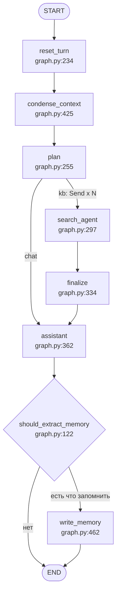

# AGENT — граф ассистента

Документ описывает пакет `agent/` — граф LangGraph, состояние, память,
кастомные события и промпты. Код намеренно очищен от пояснительных
комментариев: логика, причины и подсчёты собраны здесь, со ссылками на модули
и строки, чтобы исходник оставался компактным.

```text
agent/
  graph.py                     # сборка графа, узлы, рёбра, обработка ошибок модели
  state.py                     # AgentState / SearchAgentState (схемы состояния)
  planner.py                   # планировщик: режим chat/kb и подзапросы
  search_agent.py              # ветка-поиск: ReAct-сабграф с инструментом retrieve_kb
  prompts.py                   # все большие промпты одним модулем
  events.py                    # кастомные события в конверте {"aist": ...}
  grading.py                   # грейдер фрагментов (выключен по замеру)
  numbers.py                   # сверка чисел ответа с контекстом
  memory_gate.py               # «есть ли что запомнить из этого сообщения»
```

Зависимость от слоёв: агент импортирует `domain.context` (сжатие истории) и
`infrastructure.retrieval` (протокол `Search`, `SearchUnavailable`), а GUI **не
зависит от агента**: контракт на события, поток `client.runs.stream` и конверт
`{"aist": ...}` описаны в `docs/GUI.md` и `docs/RETRIEVE.md`.

## Общая схема графа

Граф собирается функцией `create_app_agent` (`graph.py:193`) из семи узлов:



Узлы и роли:

| Узел | Строка | Что делает |
| --- | --- | --- |
| `reset_turn` | graph.py:234 | Сброс одноразовых полей одного запроса (`plan`, `retrieved`, `branch_retrieved`, `failures`, `followups`, `retrieval_failed`) |
| `condense_context` | graph.py:425 | Сжатие истории диалога в `summary` + удаление старых сообщений |
| `plan` | graph.py:255 | Планировщик (`planner.plan_search`): режим `chat`/`kb` + декомпозиция на подзапросы |
| `search_agent` | graph.py:297 | Ветка-поиск: вызов ReAct-сабграфа по своему подзапросу, вклад в `branch_retrieved`/`failures` |
| `finalize` | graph.py:334 | Fan-in: дедуп, слияние ветвей, cap `top_k`, нумерация `[n]`, события `sources`/`followups` |
| `assistant` | graph.py:362 | Формирование контекста и вызов модели, проверка чисел, публикация ответа |
| `write_memory` | graph.py:462 | Обновление долгосрочной памяти о пользователе |

Состояние — `AgentState` (`state.py:44`): поле `messages` с редьюсером
`add_messages`; накопительные каналы `branch_retrieved`/`failures` с редьюсером
`merge_or_reset` (понимает сигнал `RESET_CHANNEL`); плюс необязательные поля
`summary`, `sections`, `areas`, `docs`, `query`, `plan`, `retrieved`,
`followups`, `retrieval_failed`. Состояние ветки — `SearchAgentState`
(`state.py:61`).

`checkpointer` и `store` (память) передаются как опции `compile()`
(`graph.py:553-558`); контейнер создаёт их в
`infrastructure/config/composition_root.py`, вне процессов соединений.

## reset_turn (graph.py:234)

Первый узел каждого входа: обнуляет одноразовые поля — `plan=None`,
`retrieved=[]`, `followups=[]`, `retrieval_failed=False`, а накопительным
каналам `branch_retrieved`/`failures` ставит сигнал `RESET_CHANNEL`.
Без этого служебные поля «склеивали» бы разные запросы: у каналов
редьюсер-сумматор, и пустой список он применил бы как `current + []`,
то есть не сбросил бы ничего.

## condense_context (graph.py:425)

Если узел не получил `context_manager`, он возвращает `{}` (выход без
изменений). В составе (`composition_root.py:31`) передаётся
`ContextManager(llm=support_model, budget=16000)` (домен: `domain/context/manager.py`).

Логика `ContextManager.condense` (`domain/context/manager.py:14`):

- оценить размер диалога (`len(str(m.content)) // 2` — грубая метрика токенов);
- если диалог вместе с существующей сводкой укладывается в `budget` — вернуть
  `None` (сжатие не нужно);
- иначе старые сообщения (до последних `keep_last`) сжимаются буллетпойнтами
  через промпт «Extract key facts... / Update this structured fact list»;
- полученная сводка кладётся в `summary`; старые сообщения удаляются через
  `RemoveMessage` (`graph.py:456-459`), чтобы не дублировать текст;
- если модель не ответила (ошибка семейства `MODEL_ERRORS`) — `logwarning`,
  сжатие пропускается (граф не падает, диалог просто становится длиннее);
- пустое резюме — тоже отказ: история не удаляется (graph.py:448-453).

Сводка передаётся модели внутри блока `<internal_context>` (graph.py:397-406), в
GUI она не выводится.

## plan (agent/planner.py, graph.py:255)

Планировщик решает, искать ли в базе вообще и как разбить вопрос:

- `plan_search` (`planner.py:112`) вызывает `support_model.raw.with_structured_output(SearchPlan)`
  с промптом `PLAN_PROMPT`; при сбое структурированного вывода план
  запрашивается обычным сообщением, JSON вырезается из текста
  (`parse_plan_json`, planner.py:45) — этот запасной путь спасает модели,
  которые возвращают пустоту на структурированный вывод (gpt-oss);
- предел подзапросов считается от бюджета поиска:
  `max_subqueries = retrieval_max_requests // (branch_retries + 1)` (planner.py:16);
- режим `chat` («Привет!», «спасибо») завершает граф поиском — ветки не
  запускаются; полный сбой планировщика даёт безопасный фолбэк
  `kb [исходный вопрос]`;
- флаг `always_answer_with_db` (из GUI) принудительно включает kb-режим без
  обращения к модели.

Проверка планировщика отдельным прогоном: `uv run python scripts/check_planner.py`.

## search_agent → finalize (graph.py:297, 334)

Каждый подзапрос исполняется **параллельной веткой** (`Send` в
`initiate_search_agents`, graph.py:276): скомпилированный ReAct-сабграф из
`search_agent.build_search_agent` (`search_agent.py:29`) с единственным
инструментом `retrieve_kb`. Модель сама решает, когда поиска достаточно;
при пустой выдаче инструменту предлагается переформулировать запрос
официальными терминами регламента и повторить поиск — до `max_rounds =
branch_retries + 1` обращений. Это и есть коррекция запроса: она живёт внутри
ветки, а не отдельным узлом.

Ветка возвращает только накопительные каналы (`branch_retriebed`, `failures`),
каждый фрагмент помечен своим подзапросом (`subquery`). Узел `finalize`
(graph.py:334) делает fan-in: дедуп по `chunk_id`, слияние ветвей по кругу —
каждому подзапросу своя доля мест (`_merge_branches`), cap `top_k`,
перенумерация `[n]`, единые события `sources`/`followups`,
`retrieval_failed = bool(failures) and not retrieved`.

## assistant (graph.py:362)

Основной узел генерации:

1. подгружается долгосрочная память пользователя через `store.asearch`
   (namespace `("memories", user_id)`, graph.py:368-370);
2. строится контекст: при `retrieval_failed` — строгий текст «поиск временно
   недоступен» (graph.py:372-378), иначе — нумерованные выдержки `[n]` из
   `retrieved`, при пустой выдаче — «в базе знаний нет выдержек»;
3. в системном сообщении подставляются память, контекст и сегодняшняя дата
   (`prompts.py:1`, формат `MODEL_SYSTEM_MESSAGE`);
4. если есть `summary` — добавляется блок `<internal_context>`
   (graph.py:397-406);
5. вызов `model.ainvoke(messages=all_messages)`;
6. при ошибке модели (семейство `MODEL_ERRORS`, graph.py:32) — ответ
   `MODEL_UNAVAILABLE_TEXT` и событие `trace` со `status: model_unavailable`;
   узел не падает (graph.py:408-413);
7. если включена проверка чисел (`verify_numbers`) — `annotate_numbers(text,
   context)` (`agent/numbers.py:88`) помечает числа, которых нет в контексте.

Ответ кладётся в `messages` как `AIMessage`.

### О числах — numbers.py

`MODEL_SYSTEM_MESSAGE` прямо требует «каждое число — из CONTEXT, дословно». Это
гарантия против выдуманных значений. Поверх числа проверяются пост-обработкой,
и неподтверждённые помечаются припиской — `WARNING_TEMPLATE`
(`numbers.py:82`).

## should_extract_memory / write_memory (graph.py:122, 462)

Решение, стоит ли трогать память, принимает `memory_gate.worth_extracting`
(`agent/memory_gate.py:39`): ищет маркеры от первого лица («я», «мне»,
«зовут», «работаю», «должность» и т.п.) в недавних пользовательских
сообщениях. Без маркеров (например, «Что в базе о расследовании несчастных
случаев?») `write_memory` не вызывается — вызов модели на безличный вопрос не
тратится.

`write_memory` (graph.py:462-527):

- собирает промпт по памяти (count/max, существующие пункты, последние
  реплики);
- вызывает `support_model` с промптом `MEMORY_EXTRACT_PROMPT` (`prompts.py:27`);
- парсит JSON по контракту `{"memories": [...]}` через `domain/memory/schema.py`;
- синхронизирует `store`: удаляются устаревшие пункты (`store.adelete`),
  добавляются новые (`store.aput`), пустой набор при непустой памяти
  игнорируется (один неудачный ответ модели не стирает всё досье).

Память — это **устойчивые факты о человеке** (имя, должность, допуски), а не
журнал вопросов; промпт явно не позволяет запоминать «о чём спрашивал».

## Промпты — prompts.py

| Константа | Строка | Назначение |
| --- | --- | --- |
| `MODEL_SYSTEM_MESSAGE` | prompts.py:1 | Системный промпт ассистента: ответы по CONTEXT, отказы, числа, память |
| `MEMORY_EXTRACT_PROMPT` | prompts.py:27 | Извлечение/обновление фактов о пользователе |
| `GRADE_PROMPT` | prompts.py:49 | Промпт грейдера (применение — в `docs/RETRIEVE.md`) |
| `PLAN_PROMPT` | prompts.py:58 | Планировщик: режим и подзапросы |
| `SEARCH_AGENT_PROMPT` | prompts.py:71 | Системный промпт ветки-поиска (ReAct, лимит обращений) |

## Кастомные события — events.py

`emit(kind, payload)` (`agent/events.py:10`) пишет событие в ветку стрима в
конверте `{"aist": {"v": 1, "kind": ..., "payload": ...}}`. Допустимые
`kind` ограничены `ALLOWED_KINDS` (`events.py:7`): `trace`, `sources`,
`followups`, `related`; иное имя — `ValueError`. События читаются в GUI
(`docs/GUI.md`) и инструментах трассировки. Ошибка стрима не должна ронять
узел — `emit` перехватывает исключения.

| kind | Генерируется | Назначение |
| --- | --- | --- |
| `sources` | finalize | панель «Источники» |
| `followups` | finalize | подсказки-уточнения |
| `trace` | все долгие узлы | этапы выполнения и статусы |
| `related` | — | зарезервировано |

### Этапы выполнения (`kind="trace"`)

Полезная нагрузка обязательно содержит `stage` (узел) и `status`. Событие со
`status: "start"` шлётся **до** работы узла, `status: "done"` — после; на
сбое узел шлёт `error`, `model_unavailable` или `unavailable`. Пары
«start/done» нужны интерфейсу: событие о завершении приходит, когда узел уже
отработал, и по нему одному пользователь всё так же ждал бы молча
(`docs/GUI.md`, «Этапы работы графа»).

| stage | Узел | Поля при `done` |
| --- | --- | --- |
| `condense` | condense_context | `condensed` (0/1) |
| `plan` | plan | `mode`, `subqueries` |
| `search_agent` | search_agent | `query`, `retrieved`, `failed` |
| `finalize` | finalize | `retrieved`, `failures`, `retrieval_failed` |
| `assistant` | assistant | — |

**Ветки поиска идут параллельно**, поэтому события `search_agent` несут
`query`: без него события веток неразличимы и интерфейс не сможет свести
начало и конец одной ветки.

**Этап `condense` шлётся не всегда**: узел сначала спрашивает
`ContextManager.should_condense` (проверка дешёвая, без модели) и молчит,
когда история укладывается в бюджет. Иначе этап мигал бы на каждом сообщении,
ничего при этом не делая.

## Грейдер фрагментов — grading.py

Реализован: `grade_chunks` (`agent/grading.py:30`), промпт `GRADE_PROMPT`,
структура `GradeResult.v: list[Verdict]` (вердикт «релевантно/частично/нет»).
**Выключен** по умолчанию (config `GRADING_ENABLED=0`). Причины и замеры на
полном пути ответа — в `docs/RETRIEVE.md` (раздел «Грейдер релевантности»).
Код предусматривает расхождение длины вердиктов с числом фрагментов (→ `None`)
и форматирование фрагментов.

## Сборка и контейнер

- Сборка производится в `infrastructure/config/composition_root.py`
  (`create_application`): `create_app_agent(model, support_model,
  context_manager, store=InMemoryStore(), checkpointer=MemorySaver(),
  search=..., max_requests=..., branch_retries=..., top_k=...,
  verify_numbers=...)`.
- Реестр моделей и эмбеддингов — `infrastructure/config/model_registry.py`
  (два слота: `default` для ответа, `support` для служебных задач); модели
  подбираются из настроек в `infrastructure/config/settings.py`.
- Контейнер и compose-слои — `docs/DEPLOY.md` (слой base: сервис `aegra`).

## Смежные документы

- Поиск, пороги, грейдер, реранкер — `docs/RETRIEVE.md`.
- Индексация и Prefect — `docs/INGEST.md`, `docs/DEPLOY.md`.
- Интерфейс и событийный контракт — `docs/GUI.md`.
- Тесты — `docs/TESTS.md`.