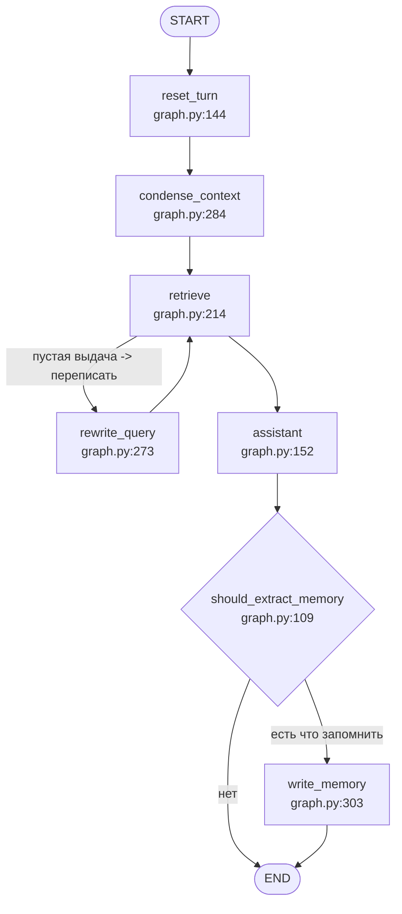

# AGENT — граф ассистента

Документ описывает пакет `agent/` — граф LangGraph, состояние, память,
кастомные события и промпты. Код намеренно очищен от пояснительных
комментариев: логика, причины и подсчёты собраны здесь, со ссылками на модули
и строки, чтобы исходник оставался компактным.

```text
agent/
  graph.py                     # сборка графа, узлы, рёбра, обработка ошибок модели
  state.py                     # AgentState (схема состояния)
  prompts.py                   # все большие промпты одним модулем
  events.py                    # кастомные события в конверте {"aist": ...}
  correction.py                # переписывание запроса при пустой выдаче
  grading.py                   # грейдер фрагментов (выключен по замеру)
  numbers.py                   # сверка чисел ответа с контекстом
  memory_gate.py               # «есть ли что запомнить из этого сообщения»
```

Зависимость от слоёв: агент импортирует `domain.context` (сжатие истории) и
`infrastructure.retrieval` (протокол `Search`, `SearchUnavailable`), а GUI **не
зависит от агента**: контракт на события, поток `client.runs.stream` и конверт
`{"aist": ...}` описаны в `docs/GUI.md` и `docs/RETRIEVE.md`.

## Общая схема графа

Граф собирается функцией `create_app_agent` (`graph.py:128`) из шести узлов:



Узлы и роли:

| Узел | Строка | Что делает |
| --- | --- | --- |
| `reset_turn` | graph.py:144 | Сброс одноразовых полей одного запроса (`query`, `rewrite_attempts`, `needs_rewrite`, `retrieval_failed`) |
| `condense_context` | graph.py:284 | Сжатие истории диалога в `summary` + удаление старых сообщений |
| `retrieve` | graph.py:214 | Гибридный поиск по базе знаний, публикация событий `sources`/`followups` |
| `rewrite_query` | graph.py:273 | Переписывание запроса при пустой выдаче (максимум `max_rewrites` раз) |
| `assistant` | graph.py:152 | Формирование контекста и вызов модели, проверка чисел, публикация ответа |
| `write_memory` | graph.py:303 | Обновление долгосрочной памяти о пользователе |

Состояние — `AgentState` (`state.py:7`): поле `messages` с редьюсером
`add_messages` плюс необязательные поля `summary`, `sections`, `retrieved`,
`followups`, `areas`, `retrieval_failed`, `query`, `rewrite_attempts`,
`needs_rewrite`.

`checkpointer` и `store` (память) передаются как опции `compile()`
(`graph.py:381-387`); контейнер создаёт их в
`infrastructure/config/composition_root.py`, вне процессов соединений.

## reset_turn (graph.py:144)

Первый узел каждого входа: обнуляет одноразовые поля — `query=''`,
`rewrite_attempts=0`, `needs_rewrite=False`, `retrieval_failed=False`. Без этого
служебные поля «склеивали» бы разные запросы.

## condense_context (graph.py:284)

Если узел не получил `context_manager`, он возвращает `{}` (выход без
изменений). В составе (`composition_root.py:18`) передаётся
`ContextManager(llm=support_model, budget=16000)` (домен: `domain/context/manager.py`).

Логика `ContextManager.condense` (`domain/context/manager.py:14`):

- оценить размер диалога (`len(str(m.content)) // 2` — грубая метрика токенов);
- если диалог вместе с существующей сводкой укладывается в `budget` — вернуть
  `None` (сжатие не нужно);
- иначе старые сообщения (до последних `keep_last`) сжимаются буллетпойнтами
  через промпт «Extract key facts... / Update this structured fact list»;
- полученная сводка кладётся в `summary`; старые сообщения удаляются через
  `RemoveMessage` (`graph.py:297-300`), чтобы не дублировать текст;
- если модель не ответила (ошибка семейства `MODEL_ERRORS`) — `logwarning`,
  сжатие пропускается (граф не падает, диалог просто становится длиннее).

Сводка передаётся модели внутри блока `<internal_context>` (graph.py:188), в
GUI она не выводится.

## retrieve (agent/graph.py:214)

Что происходит в узле поиска:

- `query` берётся из состояния или выводится из последнего пользовательского
  сообщения (`query_from_state`, graph.py:121);
- вызов `search.query(query, sections=..., areas=...)` — протокол `Search`,
  реализация `QdrantSearch` и мок описаны в `docs/RETRIEVE.md`;
- результат превращается в список `Citation.to_dict()` (n, doc_code, clause,
  chunk_id, score, snippet) — graph.py:237-241; именно их видит панель
  «Источники»;
- грейдер (опционально, `grading=...`): отсев фрагментов, если отсев возможен
  (подробно в `docs/RETRIEVE.md`); по умолчанию выключен;
- если фрагменты не найдены и задана `support_model` — планируется
  переписывание запроса (`needs_rewrite=True`);
- публикуются события `sources` (graph.py:261) и `followups` (graph.py:265);
- при `SearchUnavailable` — `retrieval_failed=True`, `query` сохраняется,
  переписывание отменяется; отправляется событие `trace` со `status: unavailable`.

Пустой `query` — вернуть `{"needs_rewrite": False}` без поиска.

## rewrite_query (graph.py:273) / correction.py

Запускается из `retrieve`. Функция `rewrite_query` (`agent/correction.py:12`)
вызывает `support_model` с `REWRITE_PROMPT` (`prompts.py:49`) и возвращает
переписанный запрос. Правила фильтрации (`correction.py`):

- результат не пуст, одна строка, длина ≤ `MAX_REWRITE_CHARS` (300);
- не совпадает с исходным запросом с точностью до регистра;
- модель пытается максимум `max_rewrites` раз (в контейнере — 1, graph.py:257-261).

Если переписывание отвергнуто — `query` остаётся прежним, а `needs_rewrite`
становится `False` (петля не повторяется). При принятии отправляется событие
`trace` со `status: rewriting` (запрет — см. `correction.py`).

## assistant (graph.py:152)

Основной узел генерации:

1. подгружается долгосрочная память пользователя через `store.asearch`
   (namespace `("memories", user_id)`, graph.py:158-161);
2. строится контекст: при `retrieval_failed` — строгий текст «поиск временно
   недоступен» (graph.py:163-169), иначе — нумерованные выдержки `[n]` из
   `retrieved`, при пустой выдаче — «в базе знаний нет выдержек»;
3. в системном сообщении подставляются память, контекст и сегодняшняя дата
   (`prompts.py:1`, формат `MODEL_SYSTEM_MESSAGE`);
4. если есть `summary` — добавляется блок `<internal_context>`
   (graph.py:188-198);
5. вызов `model.ainvoke(messages=all_messages)`;
6. при ошибке модели (семейство `MODEL_ERRORS`, graph.py:31) — ответ
   `MODEL_UNAVAILABLE_TEXT` и событие `trace` со `status: model_unavailable`;
   узел не падает (graph.py:199-204);
7. если включена проверка чисел (`verify_numbers`) — `annotate_numbers(text,
   context)` (`agent/numbers.py:38`) помечает числа, которых нет в контексте.

Ответ кладётся в `messages` как `AIMessage`.

### О числах — numbers.py

`MODEL_SYSTEM_MESSAGE` прямо требует «каждое число — из CONTEXT, дословно»
(`prompts.py:17`, правила 6.1-6.2). Это гарантия против выдуманных значений.
Поверх числа проверяются пост-обработкой, и неподтверждённые помечаются
припиской — `WARNING_TEMPLATE` (`numbers.py:32`).

## should_extract_memory / write_memory (graph.py:109, 303)

Решение, стоит ли трогать память, принимает `memory_gate.worth_extracting`
(`agent/memory_gate.py:39`): ищет маркеры от первого лица («я», «мне»,
«зовут», «работаю», «должность» и т.п.) в недавних пользовательских
сообщениях. Без маркеров (например, «Что в базе о расследовании несчастных
случаев?») `write_memory` не вызывается — вызов модели на безличный вопрос не
тратится.

`write_memory` (graph.py:303-357):

- собирает промпт по памяти (count/max, существующие пункты, последние
  реплики);
- вызывает `support_model` с промптом `MEMORY_EXTRACT_PROMPT` (`prompts.py:27`);
- парсит JSON по контракту `{"memories": [...]}` через `domain/memory/schema.py`;
- синхронизирует `store`: удаляются устарелые пункты (`store.adelete`),
  добавляются новые (`store.aput`), пустые игнорируются.

Память — это **устойчивые факты о человеке** (имя, должность, допуски), а не
журнал вопросов; промпт явно не позволяет запоминать «о чём спрашивал».

## Промпты — prompts.py

| Константа | Строка | Назначение |
| --- | --- | --- |
| `MODEL_SYSTEM_MESSAGE` | prompts.py:1 | Системный промпт ассистента: ответы по CONTEXT, отказы, числа, память |
| `MEMORY_EXTRACT_PROMPT` | prompts.py:27 | Извлечение/обновление фактов о пользователе |
| `REWRITE_PROMPT` | prompts.py:49 | Переписывание запроса для поиска |
| `GRADE_PROMPT` | prompts.py:60 | Промпт грейдера (применение — в `docs/RETRIEVE.md`) |

## Кастомные события — events.py

`emit(kind, payload)` (`agent/events.py:10`) пишет событие в ветку стрима в
конверте `{"aist": {"v": 1, "kind": ..., "payload": ...}}`. Допустимые
`kind` ограничены `ALLOWED_KINDS` (`events.py:7`): `trace`, `sources`,
`followups`, `related`; иное имя — `ValueError`. События читаются в GUI
(`docs/GUI.md`) и инструментах трассировки. Ошибка стрима не должна ронять
узел — `emit` перехватывает исключения.

| kind | Генерируется | Назначение |
| --- | --- | --- |
| `sources` | retrieve (graph.py:261) | панель «Источники» |
| `followups` | retrieve (graph.py:265) | подсказки-уточнения |
| `trace` | assistant/retrieve | трассировка ошибок и статусов |
| `related` | — | зарезервировано |

## Грейдер фрагментов — grading.py

Реализован: `grade_chunks` (`agent/grading.py:30`), промпт `GRADE_PROMPT`,
структура `GradeResult.v: list[Verdict]` (вердикт «релевантно/частично/нет»).
**Выключен** по умолчанию (config `GRADING_ENABLED=0`). Причины и замеры на
полном пути ответа — в `docs/RETRIEVE.md` (раздел «Грейдер релевантности»).
Код предусматривает расхождение длины вердиктов с числом фрагментов (→ `None`)
и форматирование фрагментов.

## Сборка и контейнер

- Сборка производится в `infrastructure/config/composition_root.py`
  (`create_application`): `create_app_agent(model, support_model,
  context_manager, store=InMemoryStore(), checkpointer=MemorySaver(),
  search=..., grading=..., verify_numbers=...)`.
- Реестр моделей и эмбеддингов — `infrastructure/config/model_registry.py`
  (два слота: `default` для ответа, `support` для служебных задач); модели
  подбираются из настроек в `infrastructure/config/settings.py`.
- Контейнер и compose-слои — `docs/DEPLOY.md` (слой base: сервис `aegra`).

## Смежные документы

- Поиск, пороги, грейдер, реранкер — `docs/RETRIEVE.md`.
- Индексация и Prefect — `docs/INGEST.md`, `docs/DEPLOY.md`.
- Интерфейс и событийный контракт — `docs/GUI.md`.
- Тесты — `docs/TESTS.md`.