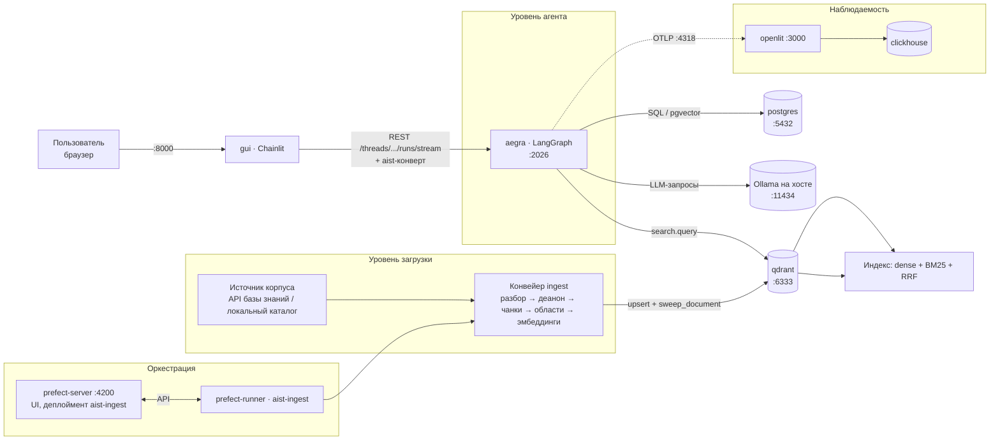
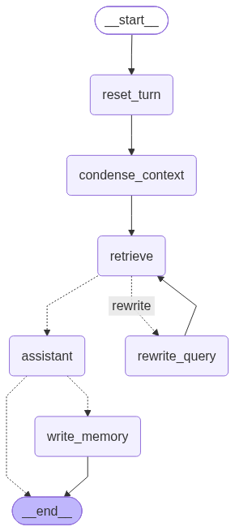
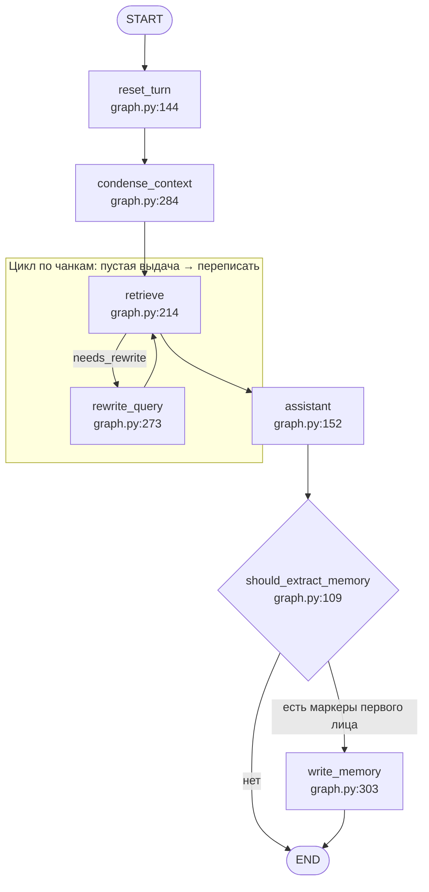
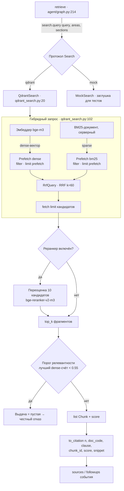
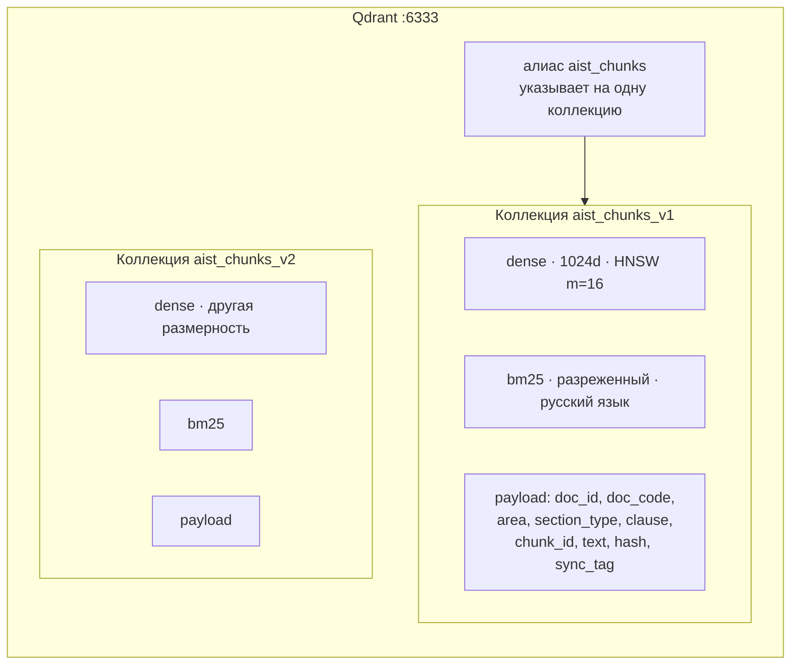
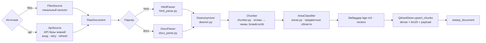
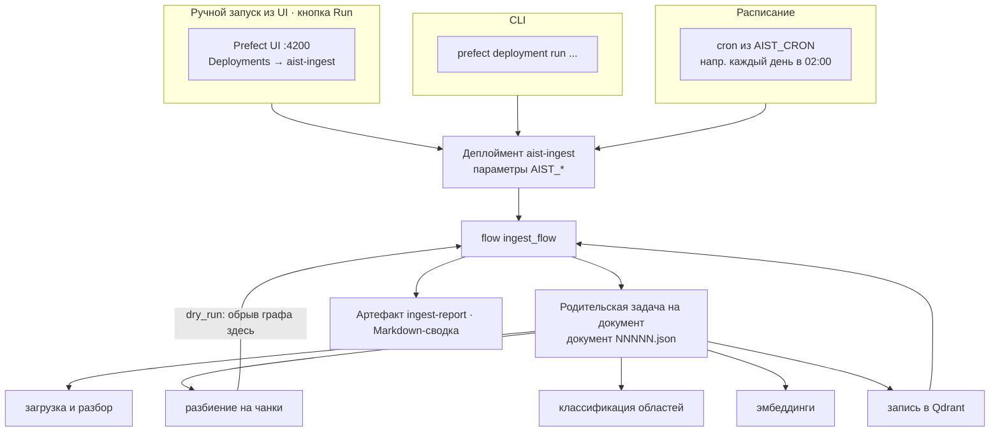
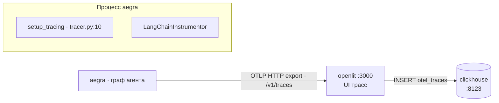

# ARCHITECTURE — общая архитектура проекта

Верхнеуровневый обзор всех слоёв системы: от вопроса в интерфейсе до хранения
индекса и автоматизации индексации. Глубина по каждому слою — в профильных
документах:

| Слой | Где описан |
| --- | --- |
| Граф ассистента | `docs/AGENT.md` |
| Поиск и retrieve | `docs/RETRIEVE.md` |
| Индексация корпуса и Prefect | `docs/INGEST.md` |
| Docker-стенд, запуск, эксплуатация | `docs/DEPLOY.md` |
| Интерфейс Chainlit и контракт событий | `docs/GUI.md` |

---

## 1. Карта системы

Три потока данных:

1. **Запрос (online).** Пользователь → Chainlit → aegra (граф LangGraph) →
   Qdrant (поиск) + Ollama (генерация) + Postgres (чекпоинтеры и история).
   Результат с панелью источников возвращается в GUI.
2. **Индексация (offline).** Источник корпуса → конвейер ingest → Qdrant.
   Запускается CLI-скриптом `scripts/ingest.py` либо деплойментом Prefect
   `aist-ingest`.
3. **Наблюдаемость (опционально).** Трассы OTLP из aegra → OpenLIT → ClickHouse.

---

## 2. Уровень агента (agent/)

Агент — граф LangGraph, собираемый `create_app_agent` (`agent/graph.py:128`).
Точка входа в рантайме — REST-канал LangGraph-сервера aegra
(`/threads/{id}/runs/stream`), а сама сборка и связывание с поиском, моделями и
памятью — в `infrastructure/config/composition_root.py:12`
(`create_application`).

Генеративная схема графа лежит в `docs/demo/graph.png` (пересоздаётся скриптом
`scripts/get_graph_visualization.py`):

Тот же граф в разрезе узлов:

Роли узлов и ссылки на строки — в `docs/AGENT.md`; здесь — схема потока:
`reset_turn` → `condense_context` → `retrieve` ⇄ `rewrite_query` (при пустой выдаче)
→ `assistant` → `write_memory` (только по маркерам первого лица).

Состояние — `AgentState` (`agent/state.py:7`): `messages` (редьюсер
`add_messages`) + `summary`, `retrieved`, `followups`, `areas`, `query` и
служебные флаги.

### Как retrieve встраивается в агента

Узел `retrieve` (graph.py:214) не знает, что стоит за протоколом `Search` —
Qdrant или заглушка; фабрика `get_search` (`factory.py:13`) подставляет
реализацию по `RETRIEVAL_PROVIDER`. Три исхода поиска («найдено / пусто /
`SearchUnavailable`») и цикл коррекции пустой выдачи описаны в `docs/RETRIEVE.md`
(разделы 2–3).

### Что делает грейдер (и почему он выключен)

`grading.py:30` (`grade_chunks`) — отсев фрагментов **моделью** перед
генерацией: одной оценкой на всю выдачу модель ставит каждому фрагменту вердикт
«релевантно / частично / нет». Реализован и замерен на полном пути ответа, но
**выключен** (`GRADING_ENABLED=0`): на текущем корпусе честный отказ он не
покупает (его делает порог 0.55 до грейдера), а с отсевом «частично» теряет
нужные фрагменты. Оставлен заготовкой под другой корпус. Детали и цифры —
`docs/RETRIEVE.md`, раздел 10.

### Как работает реранкер (включён)

Реранкер — кросс-энкодер `BAAI/bge-reranker-v2-m3` (`rerank.py:105`), **не узел
графа**, а часть `QdrantSearch`: retrieve берёт `RERANK_CANDIDATES=10`, реранкер
переранжирует, после чего — порог релевантности. Подробности, замеры и
офлайн-обёртка весов в образ — в `docs/RETRIEVE.md` (раздел 8).

---

## 3. Уровень retrieve: как получаются чанки

Внутреннее устройство узла и поискового слоя (`infrastructure/retrieval/`):

Диаграмма выше — путь чанка от `retrieve` до выдачи. Ключевые решения слоя
(фильтр в каждый `Prefetch`, порог через отдельный dense-запрос, два поля
`snippet`/`text`, payload-ключ `area`) — в `docs/RETRIEVE.md` (разделы 4–7).

---

## 4. Слой данных: Qdrant

Qdrant — векторный индекс, вынесен отдельным compose-слоем
(`deploy/docker-compose.qdrant.yml`). Приложение обращается только к **алиасу**
коллекции (`QDRANT_COLLECTION=aist_chunks`), а не к самой коллекции:

Алиас `aist_chunks` атомарно переключается между поколениями (`<alias>_v1`,
`_v2`…) через `switch_generation`; `upsert_chunks` пишет dense + sparse вместе,
`sweep_document` «подметает» устаревшие точки. BM25 считает сервер Qdrant
(`BM25_OPTIONS = {"language": "russian"}`, `bm25.py:16`); готовность индекса —
`preflight` (`qdrant_search.py:188`). Подробности схемы коллекции, payload и
лингвистики — в `docs/RETRIEVE.md` (раздел 6).

Хранение: Postgres/pgvector (чекпоинтеры графа, история GUI), SQLite в
контейнере Prefect (метаданные оркестрации), ClickHouse — только трассы OpenLIT.

---

## 5. Слой загрузки: индексация корпуса (ingest)

Offline-конвейер превращает сырые документы базы знаний в коллекцию Qdrant.
Полностью — `docs/INGEST.md`; здесь — схема пути одного документа:

Фазы конвейера (`IngestPipeline.process_document`, pipeline.py:175) — на схеме:
источник → разбор/деанон → чанкинг по атомам → классификация областей → эмбеддинги →
запись + `sweep_document`. Инкремент — хеш документа с версией конвейера
(`incremental.py`); повторный прогон без изменений — 1,76 с на 20 документах.
Коды выхода (`0`/`1`/`2`) и алиас-переключение только при успехе — в `docs/INGEST.md`.

---

## 6. Оркестрация: Prefect-обёртка

Один и тот же конвейер используется и CLI (`scripts/ingest.py`), и Prefect — без
расхождения поведения (`ingest_flow.py:279`, параметр `step` в `pipeline.py:122`):

Структура задач Prefect (пять фаз как подзадачи, `cache_policy=NO_CACHE` из-за
несериализуемого эмбеддера, артефакт `ingest-report`) и запуск через CLI/server
описаны в `docs/INGEST.md`; параметры `AIST_*`, расписание, отладка и таблица
типовых проблем — в `docs/DEPLOY.md`.

---

## 7. Наблюдаемость: уровень дебага агента — OpenLIT

Трассировка LLM-запросов агента — опциональный слой `obs`
(`deploy/docker-compose.observability.yml`, профиль `obs`, Apache-2.0). В базовый
стек не входит — включается одной переменной `OTLP_ENDPOINT`.

`setup_tracing` (`infrastructure/observability/tracer.py:10`) стартует только при
заданном `OTLP_ENDPOINT` (`service.name=aegra`, экспорт HTTP); инструментарий —
`openinference` `LangChainInstrumentor`: спан пишется на вызов графа/модели,
трассы появляютсяся после первого диалога в GUI. Смотреть в OpenLIT UI `:3000`
(диалог → трасса aegra) или SQL-счётчик в ClickHouse
(`SELECT ServiceName, count() FROM openlit.otel_traces GROUP BY ServiceName`).

Включение, проверка и типовые проблемы — в `docs/DEPLOY.md` («Запуск с
наблюдаемостью», «Устранение неполадок», «Проверка end-to-end»); локальный дебаг
графа и поиска — в `docs/RETRIEVE.md`/`docs/AGENT.md`.

Итого по уровням: интерфейс → граф агента (LangGraph) → поисковый слой (Qdrant,
гибрид dense + BM25 + RRF + порог + реранкер) → генерация (Ollama); рядом —
offline-конвейер индексации, обёрнут в Prefect; сверху — трассировка OpenLIT.
Каждый уровень разобран в своём документе из таблицы в начале.