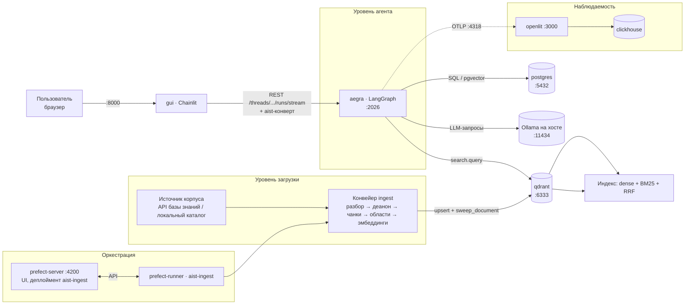
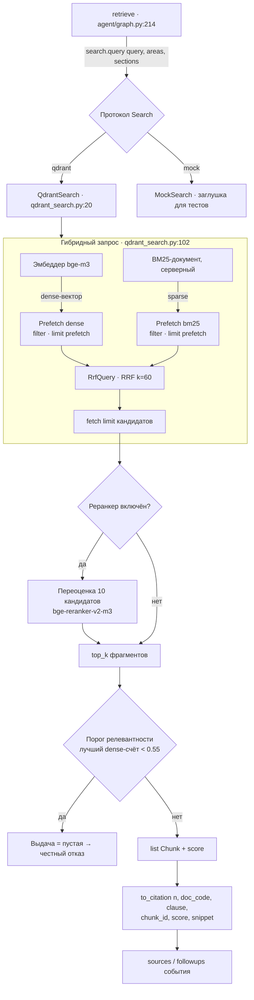
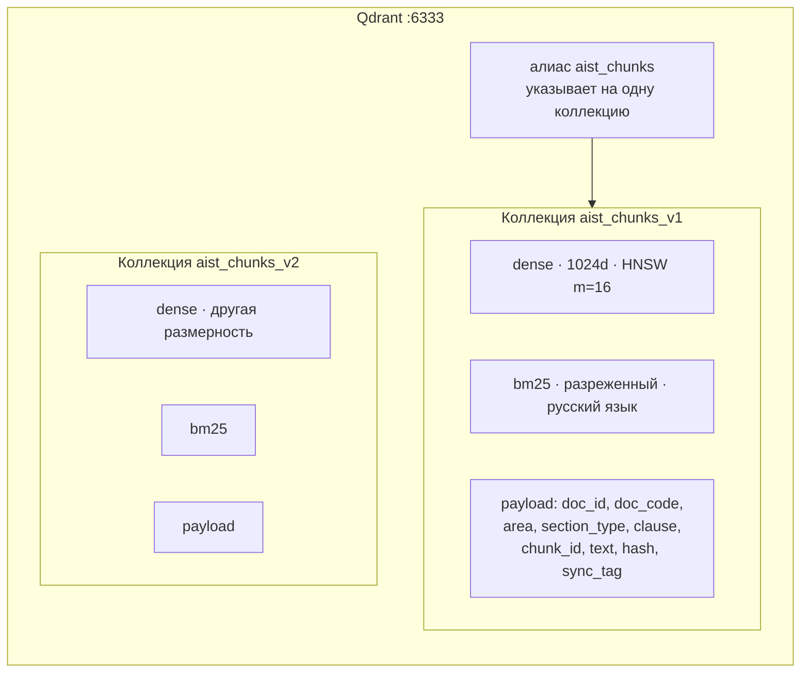
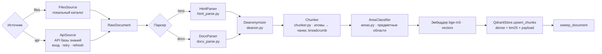
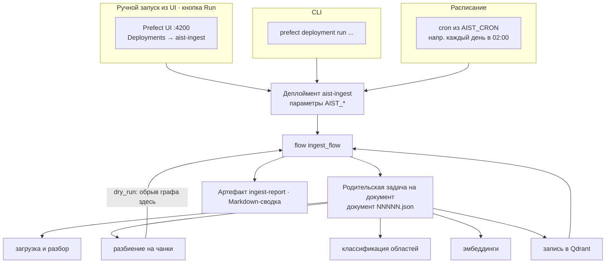
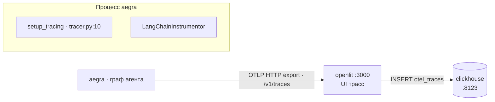

# ARCHITECTURE — общая архитектура проекта

Верхнеуровневый обзор всех слоёв системы: от вопроса в интерфейсе до хранения
индекса и автоматизации индексации. Глубина по каждому слою — в профильных
документах:

| Слой | Где описан |
| --- | --- |
| Граф ассистента | `docs/AGENT.md` |
| Поиск и retrieve | `docs/RETRIEVE.md` |
| Индексация корпуса и Prefect | `docs/INGEST.md` |
| Docker-стенд, запуск, эксплуатация | `docs/DEPLOY.md` |
| Интерфейс Chainlit и контракт событий | `docs/GUI.md` |

---

## 1. Карта системы

Три потока данных:

1. **Запрос (online).** Пользователь → Chainlit → aegra (граф LangGraph) →
   Qdrant (поиск) + Ollama (генерация) + Postgres (чекпоинтеры и история).
   Результат с панелью источников возвращается в GUI.
2. **Индексация (offline).** Источник корпуса → конвейер ingest → Qdrant.
   Запускается CLI-скриптом `scripts/ingest.py` либо деплойментом Prefect
   `aist-ingest`.
3. **Наблюдаемость (опционально).** Трассы OTLP из aegra → OpenLIT → ClickHouse.

---

## 2. Уровень агента (agent/)

Агент — граф LangGraph, собираемый `create_app_agent` (`agent/graph.py:128`).
Точка входа в рантайме — REST-канал LangGraph-сервера aegra
(`/threads/{id}/runs/stream`), а сама сборка и связывание с поиском, моделями и
памятью — в `infrastructure/config/composition_root.py:12`
(`create_application`).

Генеративная схема графа лежит в `docs/demo/graph.png` (пересоздаётся скриптом
`scripts/get_graph_visualization.py`):

Тот же граф в разрезе узлов:

Роли узлов:

| Узел | Что делает |
| --- | --- |
| `reset_turn` | Обнуляет одноразовые поля одного запроса (`query`, `rewrite_attempts`, `needs_rewrite`, `retrieval_failed`) |
| `condense_context` | Сжимает историю диалога в `summary` при превышении бюджета (16000 токенов, `domain/context/manager.py:14`) |
| `retrieve` | Гибридный поиск по базе знаний, публикует события `sources`/`followups` |
| `rewrite_query` | Переписывает запрос языком регламента при пустой выдаче (до `max_rewrites` раз, в контейнере — 1) |
| `assistant` | Собирает контекст, вызывает LLM, включает сверку чисел, публикует ответ. Вход в этот узел — **точка входа генерации** |
| `write_memory` | Обновляет долгосрочную память о пользователе (лимит 15 фактов) |

Состояние — `AgentState` (`agent/state.py:7`): `messages` (редьюсер
`add_messages`) + `summary`, `retrieved`, `followups`, `areas`, `query` и
служебные флаги.

### Как retrieve встраивается в агента

Узел `retrieve` (graph.py:214) не знает, что стоит за протоколом `Search` —
Qdrant или синтетическая заглушка. Фабрика `get_search`
(`infrastructure/retrieval/factory.py:13`) подставляет реализацию по
`RETRIEVAL_PROVIDER`. Смена боевого поиска на заглушку не трогает ни граф, ни
интерфейс.

Три исхода поиска — **разные вещи**, и граф разделяет их явно:

| Исход | Возникает | Ответ ассистента |
| --- | --- | --- |
| Найдено | `query()` вернул список | Ответ опирается на выдержки `[n]` |
| Ничего нет | `query()` вернул `[]` | «В базе знаний информации нет» (честный отказ) |
| Поиск недоступен | исключение `SearchUnavailable` (`qdrant_search.py:16`) | «Поиск временно недоступен», общие знания запрещены |

Цикл «чанки»: при пустой выдаче retrieve планирует `needs_rewrite`, граф
переходит в `rewrite_query`, тот один раз переписывает запрос языком регламента
и возвращается в `retrieve` (граф `RV → RQ → RV` выше). Если и после
переписывания выдача пуста — срабатывает порог релевантности, и ассистент
честно отвечает отказом.

### Что делает грейдер (и почему он выключен)

`grading.py:30` (`grade_chunks`) — отсев фрагментов **моделью** перед
генерацией: одной оценкой на всю выдачу модель ставит каждому фрагменту вердикт
«релевантно / частично / нет». Реализован и замерен на полном пути ответа, но
**выключен** (`GRADING_ENABLED=0`): на текущем корпусе честный отказ он не
покупает (его делает порог 0.55 до грейдера), а с отсевом «частично» теряет
нужные фрагменты. Оставлен заготовкой под другой корпус. Детали и цифры —
`docs/RETRIEVE.md`, раздел 10.

### Как работает реранкер (включён)

Реранкер — кросс-энкодер `BAAI/bge-reranker-v2-m3` (`rerank.py:105`), **не узел
графа**: он встроен в `QdrantSearch`. На входе — пара («запрос», «фрагмент»), на
выходе — переранжирование выдачи. Поэтому retrieve сначала берёт больше
кандидатов (`RERANK_CANDIDATES=10`, qdrant_search.py:88-92), реранкер выбирает
из них `top_k`, и уже после этого идёт проверка порога. Эффект измерен: hit@1
+17 пунктов (0.561 → 0.732) при +175 мс к поиску на демо-машине. Веса запечены
в образ при сборке, `HF_HUB_OFFLINE=1`.

---

## 3. Уровень retrieve: как получаются чанки

Внутреннее устройство узла и поискового слоя (`infrastructure/retrieval/`):

Ключевые решения, заложенные в этот слой:

- **Фильтр по областям (`areas`) и разделам (`section_type`) ставится в каждый
  `Prefetch`**, а не верхнеуровневым фильтром — ограничение выражено там, где
  отбираются кандидаты (`_build_filter`, `qdrant_search.py:45`).
- **Порог «честного отказа»** считается не по RRF-счёту (он непригоден при
  `k=60`), а отдельным dense-запросом с `limit=1` (`_best_dense_score`,
  qdrant_search.py:170). Лучший косинус ниже `RETRIEVAL_MIN_RELEVANCE=0.55` —
  выдача считается пустой.
- **Два поля на чанк:** `snippet` (400 символов) — в панель «Источники», полный
  `text` — в контекст модели. Модель должна видеть весь пункт, включая числовые
  требования во второй половине абзаца (`search.py`).
- Фильтр областей работает по payload-ключу `area`, который проставляется ещё на
  этапе индексации классификатором областей (см. раздел про ingest).

---

## 4. Слой данных: Qdrant

Qdrant — векторный индекс, вынесен отдельным compose-слоем
(`deploy/docker-compose.qdrant.yml`). Приложение обращается только к **алиасу**
коллекции (`QDRANT_COLLECTION=aist_chunks`), а не к самой коллекции:

- **Поколения вместо перезаписи.** Размерность dense-вектора неизменяема, смена
  эмбеддера требует новой коллекции. `switch_generation` (`store.py:190`)
  атомарно переключает алиас: «записать в новое поколение, при успехе —
  переключить». Старые коллекции остаются путём отката.
- **Оба вектора пишутся вместе** (`upsert_chunks`, store.py:113): запись только
  dense молча обнулила бы лексический канал BM25.
- **«Записать, потом подмести»** (`sweep_document`, store.py:162): удаляет точки
  с чужим `sync_tag` — документ никогда не пропадает из индекса на время
  перезаписи.
- **BM25 считает сервер Qdrant** (встроен с 1.15.2, минимум 1.16.0 проверяется
  на старте). `BM25_OPTIONS = {"language": "russian"}` — единая точка правды для
  записи и запроса (`bm25.py:16`): расхождение ошибки не даёт, но портит выдачу.
- **Готовность индекса проверяется на старте** `preflight`
  (`qdrant_search.py:188`): алиас должен существовать и быть непустым, иначе
  `SearchUnavailable`.

Хранение сопроводительных данных: Postgres/pgvector (чекпоинтеры графа,
история GUI), SQLite в контейнере Prefect (метаданные оркестрации), ClickHouse —
только трассы OpenLIT.

---

## 5. Слой загрузки: индексация корпуса (ingest)

Offline-конвейер превращает сырые документы базы знаний в коллекцию Qdrant.
Полностью — `docs/INGEST.md`; здесь — схема пути одного документа:

Фазы конвейера `IngestPipeline.process_document`
(`infrastructure/ingest/pipeline.py:175`):

1. **Загрузка исходника** — `source.fetch_document(ref.doc_id)`.
2. **Разбор и деанонимизация** — HTML или `.docx` (zipfile + re, без внешних
   зависимостей), затем пофайловый словарь `[ОРГАНИЗАЦИЯ_N]` → расшифровка
   (`parse_raw`, pipeline.py:101).
3. **Чанкинг по атомам** — регламент режется на атомарные пункты, из них чанки
   с «breadcrumb»-навигацией вместо overlap (`chunker.py`).
4. **Классификация областей** — детерминированно по заголовку документа:
   пожарная безопасность, охрана труда, ГО и ЧС, промышленная и производственная
   безопасность, работы повышенной опасности (`areas.py`).
5. **Эмбеддинги** — каждый чанк → вектор bge-m3.
6. **Запись** — `upsert_chunks` пишет dense + sparse + payload,
   `sweep_document` подметает устаревшие точки.

**Инкрементальный режим.** Признак изменения — хеш разобранного документа
вместе с версией конвейера (`incremental.py`), а не `updated_at` источника.
Состояние читается из самого индекса (`content_hash` в payload). Повторный
прогон без изменений — 1,76 с на 20 документах; полная индексация — ~4-5 мин
(узкое место — эмбеддинги, не загрузка).

Коды выхода: `0` — всё обработано, `1` — часть документов не обработана,
`2` — прогон не начался. При ошибках **алиас не переключается**: неполное
поколение в прод не уезжает.

---

## 6. Оркестрация: Prefect-обёртка

Один и тот же конвейер используется и CLI (`scripts/ingest.py`), и Prefect — без
расхождения поведения (`ingest_flow.py:279`, параметр `step` в `pipeline.py:122`):

Как это устроено:

- **Пять фаз — пять подзадач** (`ingest_flow.py:73-161`), чтобы в UI граф шагов
  был виден, а не «одной таской». Имена задач берутся колбэком из `ref.doc_id`
  (`ingest_flow.py:47,57`), поэтому в UI легко отличить документы.
- Родительская задача повторяет `process_document` с той же сверкой хэшей и
  режимами `dry_run`/`full` (`ingest_document_step`, ingest_flow.py:170).
- Артефакт `ingest-report` в конце прогона: источник, коллекция, документы,
  чанки, ошибки, переключение алиаса (`acreate_markdown_artifact`,
  ingest_flow.py:349).
- Все задачи с `cache_policy=NO_CACHE`: среди аргументов — живой эмбеддер,
  который не сериализуется в ключ кэша, плюс инкрементальный пропуск делает сам
  конвейер через хэши.
- `serve.py:32` регистрирует деплоймент при старте раннера и держит воркер.
  Расписание (cron/interval) читается из `AIST_CRON`/`AIST_INTERVAL`.

---

## 7. Дебаг и автоматизация через Prefect

Слой `orc` (server + runner) поднимается корневым compose; UI на `:4200`.

**Три способа запустить индексацию** — все ведут в один flow `aist-ingest`:

1. **Из GUI**: Deployments → aist-ingest → **Run**, в форме правятся параметры
   (`source_kind` files/api, `section_id`, `limit`, `dry_run` ...). Источник базы
   знаний и локальный корпус переключаются из браузера, без правки файлов.
2. **По CLI**: `prefect deployment run 'aist-ingest/aist-ingest' --param source_kind=api`.
3. **Автоматически по cron** (`AIST_CRON="0 2 * * *"` = ежедневно в 02:00).
   Prefect-планировщик создаёт flow run по расписанию, раннер исполняет его в
   своей очереди. После правки `AIST_CRON` контейнер раннера надо пересоздать —
   расписание живёт в сохранённых метаданных сервера.

**Где смотреть результат** — Runs → Flow runs → конкретная запись:

| Вкладка | Что показывает |
| --- | --- |
| Runs / Task runs | Каждый документ — ветка пяти фаз (`загрузка и разбор` … `запись`); статус, длительность, ошибки по каждой |
| Logs | Журнал «начало / готово, чанков N» по каждому документу и фазе |
| Artifacts | Markdown-сводка `ingest-report` (привязана к прогону) |

Типичные отладочные ситуации и кнопки (`Task re-run`, `Rerun`, `Retry`),
переменные `AIST_*` и таблица диагностики — в `docs/DEPLOY.md` (разделы
«Оркестрация» и «Как дебажить») и `docs/INGEST.md` (разделы про запуск и UI).

---

## 8. Наблюдаемость: уровень дебага агента — OpenLIT

Трассировка LLM-запросов агента — опциональный слой `obs`
(`deploy/docker-compose.observability.yml`, профиль `obs`, Apache-2.0). В базовый
стек не входит — включается одной переменной `OTLP_ENDPOINT`.

- `setup_tracing` (`infrastructure/observability/tracer.py:10`) стартует, только
  если задан `OTLP_ENDPOINT`; `service.name=aegra`, экспорт HTTP с таймаутом 10 с.
- Инструментарий — `openinference` `LangChainInstrumentor`: спан пишется на вызов
  графа/модели. Трассы появляются после первого реального диалога в GUI.
- Смотреть: OpenLIT UI `:3000` (диалог → трасса aegra), либо SQL-счётчик в
  ClickHouse (`SELECT ServiceName, count() FROM openlit.otel_traces GROUP BY ServiceName`).
- Дебаг графа без UI: `scripts/cli_chat.py` (агент локально) и
  `scripts/server_cli.py` (через HTTP aegra). Дебаг поиска и индексации —
  `scripts/evaluate.py` (замер на золотом наборе) и `benchmark.py` (операционный
  замер).

Итого по уровням: интерфейс → граф агента (LangGraph) → поисковый слой (Qdrant,
гибрид dense + BM25 + RRF + порог + реранкер) → генерация (Ollama); рядом —
offline-конвейер индексации, обёрнут в Prefect; сверху — трассировка OpenLIT.
Каждый уровень разобран в своём документе из таблицы в начале.