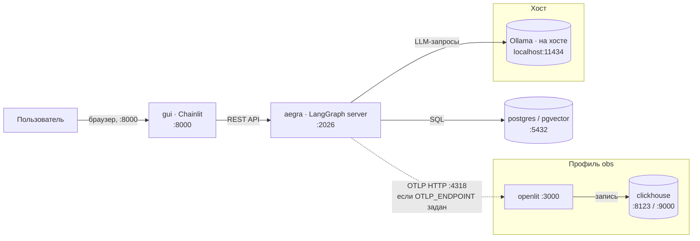
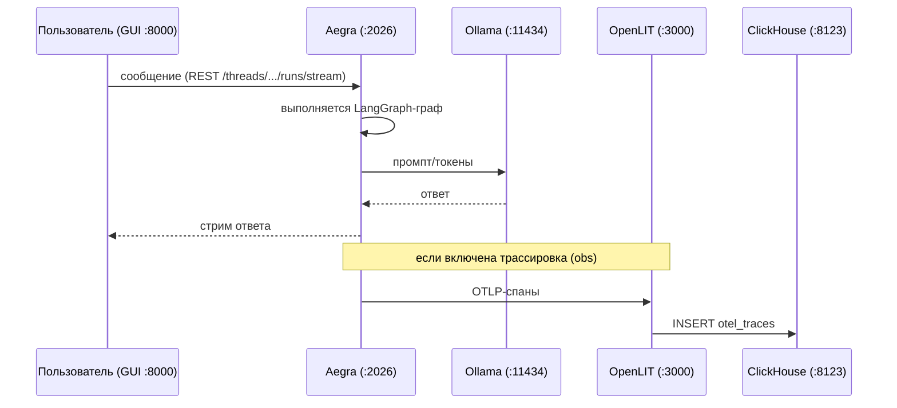

# DEPLOY — запуск и эксплуатация

Docker-стек AI-агента, собранный из слоёв: базовый (`postgres`, `aegra`, `gui`),
индекс (`qdrant`), оркестрация (`prefect-server`, `prefect-runner`). Корневой
`docker-compose.yml` подключает эти слои через `include` — весь стенд поднимается
`docker compose up -d`. Опционально подключается наблюдаемость LLM: `openlit` +
`clickhouse` (compose-профиль `obs`).

## Архитектура

> Полная концептуальная карта стенда (Qdrant, конвейер ingest, Prefect) — в
> `docs/ARCHITECTURE.md`; ниже — схема выполнения запроса в runtime.





## Состав сервисов

Стек собран из **слоёв**, каждый — отдельный compose-файл в `deploy/`; корневой
`docker-compose.yml` подключает их через `include`, поэтому `docker compose up -d`
поднимает весь стенд одной командой. Слой можно поднять или остановить отдельно
(`docker compose -f docker-compose.qdrant.yml ...`).

| Сервис      | Роль                                                        | Порты (host)              | Слой |
| ----------- | ----------------------------------------------------------- | -------------------------- | --- |
| `postgres`  | Postgres + pgvector: чекпоинтеры, состояние, БД GUI          | `5432`                     | base |
| `aegra`     | LangGraph runtime: REST API графа                            | `2026`                     | base |
| `gui`       | Chainlit-интерфейс для браузера                              | `8000`                     | base |
| `qdrant`    | Векторный индекс: гибридный поиск dense + BM25 + RRF          | `6333` (HTTP), `6334` (gRPC) | qdrant |
| `prefect-server` / `prefect-runner` | Оркестрация индексации: UI, deployment aist-ingest | `4200` (UI) | orc |
| `openlit`   | LLM-наблюдаемость: приём OTLP, UI трасс                     | `3000`, `4317` (gRPC), `4318` (HTTP) | obs |
| `clickhouse`| Хранилище трасс OpenLIT (Apache-2.0)                        | `8123` (HTTP), `9000` (native) | obs |

Слои: **base** (`postgres` + `aegra` + `gui`, одна БД на интерфейс и агента),
**qdrant** (база знаний), **orc** (Prefect), **obs** (OpenLIT, только по
`--profile obs`). Индекс `qdrant` вынесен из базы отдельным слоем: перезапуск
`postgres`/`aegra`/`gui` его не затрагивает, а команды `docker compose down qdrant`
пустят его отдельно без остановки остального.

Все образы OpenLIT/ClickHouse — Apache-2.0; анонимная телеметрия OpenLIT отключена (`TELEMETRY_ENABLED=false`).

## Предварительные требования

1. **Docker Desktop** (с docker-compose v2).
2. **Ollama** запущен **на хосте** (не в Docker) и доступен по `http://localhost:11434`.
   - Контейнеры обращаются к нему через `http://host.docker.internal:11434`.
   - Должны быть скачаны модели `LLM_MODEL` и `EMBEDDING_MODEL` из `.env`:

     ```sh
     ollama pull gpt-oss:20b   # генерация ответа (демо-модель, 48 ГБ)
     ollama pull bge-m3       # эмбеддинги, 1024 измерения
     ```

   - Размерность эмбеддера прошита в схему коллекции Qdrant. Смена модели
     требует нового поколения коллекции и переиндексации, иначе поиск падает
     с «expected dim: 1024».
3. Свободные порты: `5432, 6333, 6334, 2026, 8000` (base) и `3000, 4317, 4318, 8123, 9000` (obs).
4. Около 10 ГБ свободного места на диске под образы и индекс (образ aegra
   вырос до ~6 ГБ после того, как веса переоценки запечены в него при сборке).

## Первый запуск

```sh
cd deploy

# 1. Конфигурация
cp .env.example .env
# при необходимости поправьте .env (модели, URL Ollama, пароли)

# 2. Запуск стенда. Корневой compose включает слои qdrant и оркестрации,
# поэтому одной командой поднимается всё (кроме obs).
docker compose up -d
```

> Сервисы лёгких в слоях, подключённых через `include` из корневого
> `docker-compose.yml`, поэтому `docker compose up -d` поднимает
> `postgres`/`aegra`/`gui` **и** `qdrant`, `prefect-server`, `prefect-runner`.
> Слой можно поднять/остановить отдельно:
>
> ```sh
> docker compose -f docker-compose.qdrant.yml up -d          # только индекс
> docker compose -f docker-compose.orchestration.yml up -d   # только оркестрацию
> ```

Проверка состояния:

```sh
docker compose ps            # postgres и qdrant — (healthy), aegra, gui и prefect-* — Up
open http://localhost:8000 # интерфейс: логин admin / admin
open http://localhost:2026/health  # {"status":"healthy",...}
```

### 3. Индексация корпуса — обязательный шаг

Без него стек поднимется и интерфейс откроется, но на **любой** вопрос
ассистент будет честно отвечать «В базе знаний информации нет»: индекс пуст,
искать не в чем.

```sh
cd ..                                   # в корень репозитория
uv run python scripts/ingest.py --source files --switch-alias
```

Из API базы знаний вместо папки — то же самое с `--source api`; учётные
данные берутся из `KB_EMAIL` и `KB_PASSWORD` в `.env`.

Индексация занимает около 4-5 минут на 20 документов (1475 фрагментов);
узкое место — вычисление эмбеддингов, а не загрузка в Qdrant. Повторный
запуск на неизменившемся корпусе отрабатывает за пару секунд: документы
сверяются по хешу и переиндексируются только изменившиеся.

Проверка, что индекс на месте:

```sh
curl -s http://localhost:6333/collections/aist_chunks | grep -o '"points_count":[0-9]*'
```

### 4. Замер качества (необязательно, но полезно)

```sh
uv run eval run --with-answers
```

Считает hit@k, MRR и долю верных отказов на золотом наборе вопросов. Это
способ убедиться, что после смены модели или настроек качество не просело.
A/B-сравнение вариантов — `uv run eval ab --variants variants.json`,
операционная задержка — `uv run eval bench`. Историю всех прогонов и таблицу
метрик собирает `uv run eval report` в [docs/BENCHMARK.md](../docs/BENCHMARK.md).

> Важно: первый запуск собирает образы `aegra` и `gui` из исходников
> (`docker compose build` выполняется автоматически при отсутствии образа).

### Запуск с наблюдаемостью (опционально)

Трассировка LLM. Проверка того, что она работает: после диалога в OpenLIT на :3000 появится трасса аegra.

```sh
cd deploy
cp .env.example .env

# 1. Включить endpoint трассировки в .env
echo 'OTLP_ENDPOINT=http://openlit:4318' >> .env   # обычно просто раскомментируйте строку

# 2. Поднять ВСЁ (корневой compose + obs):
docker compose -f docker-compose.observability.yml --profile obs up -d --remove-orphans
```

Проверка:

```sh
docker compose -f docker-compose.observability.yml --profile obs ps
# openlit и clickhouse должны быть (healthy)

open http://localhost:3000   # OpenLIT UI
# Вход: логин user@openlit.io, пароль openlituser
```

> Трассы появятся после первого реального диалога в GUI (:8000). Пустые трассы — нет (см. Troubleshooting).

> Почему две команды? Compose по умолчанию читает только `docker-compose.yml`. Профиль `obs` и сервисы OpenLIT объявлены в **отдельном файле** `docker-compose.observability.yml`, поэтому его нужно явно указывать флагом `-f` — иначе `--profile obs` молча ничего не поднимет.

### Оркестрация индексации через Prefect

Индексацию можно гонять не только по команде (`python -c "из scripts"`), но и как
сервис Prefect: сервер с UI на `:4200`, деплоймент `aist-ingest`,
расписание на cron и ручной запуск по кнопке из браузера. Слой `orc` подключён
к корневому `docker-compose.yml` через `include`, поэтому входит в
`docker compose up -d` по умолчанию — отдельного профиля больше не нужно.

```sh
cd deploy

# 1. Собрать образ раннера и поднять всё (base + qdrant + orc):
docker compose up -d --build

# 2. UI Prefect:
open http://localhost:4200   # deployments/aist-ingest/aist-ingest
```

Что происходит: контейнер `prefect-runner` поднимает `infrastructure.orchestration.serve`,
который регистрирует deployment «aist-ingest» и держит воркер, ждущий запусков.
Параметры прогона задаются переменными `AIST_*` из `.env` (см. таблицу в конце):
`AIST_CRON` — расписание, `AIST_SOURCE_KIND` — `files`/`api`, `AIST_SWITCH_ALIAS` —
принимать ли поколение после успешного прогона.

Ручной запуск из UI: Deployments → aist-ingest → Run. Или по CLI:

```sh
PREFECT_API_URL=http://127.0.0.1:4200/api uv run prefect deployment run 'aist-ingest/aist-ingest'
```

Ежедневный запуск настраивается расписанием деплоймента: `AIST_CRON` в `.env`
(например `AIST_CRON="0 2 * * *"` = каждые сутки в 02:00). После правки —
пересобрать раннер (`up -d --build prefect-runner`), расписание видно на
странице Deployments → aist-ingest (Schedule). Дополнительно к хеш-пропуску
инкремента прогон идёт по `/corpus` (копия выгрузки) — лучше монтировать
каталог, куда выгрузка складывается перед запуском.

### Как смотреть прогон в UI

Все прогоны собираются в **Runs → Flow runs**: там список, каждый со статусом
(Scheduled / Running / Completed / Failed), длительностью и кнопками Rerun
(повторить последние параметры) и Retry (доделать упавший). Открыв прогон:

| Вкладка | Что показывает |
| --- | --- |
| **Overview / Runs** | Дерево «Flow → таски»: каждый документ — родительская задача `документ NNNNN.json`, внутри неё ветка из пяти фаз конвейера: `загрузка и разбор`, `разбиение на чанки`, `классификация областей`, `эмбеддинги`, `запись` (+ `sweep` внутри записи). Так в UI видно весь граф шагов индексации, а не только «документ готов». |
| **Logs** | Журнал прогона: по каждому документу и каждой фазе «начало / готово, чанков N» + предупреждения конвейера. Сюда же попадает вывод конвейера благодаря `[tool.prefect] logging.extra_loggers` в `pyproject.toml`. |
| **Artifacts** | Markdown-артефакт `ingest-report` — сводка: источник, коллекция, число документов/чанков/ошибок. Создаётся из `create_markdown_artifact` в конце `ingest_flow` (пусто между прогонами, обновляется в каждом). |

То есть всё, что выглядит как «только факт выполнения» — это потому что задачи
и артефакт живут **внутри** прогона, их надо открыть кликом по конкретной записи
Flow run в списке Runs. Сразу «шаги и файлы» на главной странице UI не отображаются.

> У одной задачи фазы ветвятся по режиму: в dry-run граф обрывается на
> «разбиение на чанки» (классификация/эмбеддинги/запись не нужны), в полноценном
> прогоне с `full=true` видны все пять фаз. Если документ уже в индексе,
> обработка честно заканчивается «пропущено» до эмбеддингов — это инкремент,
> а не поломка.

### Как дебажить; куда смотреть

| Симптом | Где искать | Типичная причина |
| --- | --- | --- |
| Деплоймента нет в Deployments | `docker logs deploy-prefect-runner-1` | Раннер не успел зарегистрироваться или упал на старте; проверь, что он «serving» в логах |
| Прогон запланирован, но не бежит | Runs → прогон → Actual starts/finishes; `docker logs deploy-prefect-runner-1` | Раннер не полил очередь (процесс serve упал); рестарт: `docker compose ... restart prefect-runner` |
| Прогон красный (Failed) | Runs → прогон → Details/Logs | Смотри последние строки логов; чаще всего путь к корпусу (bind-mount берется из `AIST_CORPUS_MOUNT`, внутри он `/corpus`) или учётные данные API |
| «Документов: 0» в артефакте | Артефакт + `docker logs deploy-prefect-runner-1` | Корпус не виден из контейнера: путь `AIST_CORPUS_MOUNT` не указывает на реальную папку на хосте |
| Задачи по документам не показываются | Runs → прогон → Task Runs | Обычно просто не открыт сам прогон; если их реально нет — конвейер сработал без `step` (см. tests) |
| Логи конвейера не видно в прогоне | `dock logs deploy-prefect-runner-1` | Убедись, что `[tool.prefect] logging.extra_loggers` на месте (`pyproject.toml`) и контейнер пересобран после изменения |

Быстрый просмотр логов контейнера (не UI):

```sh
docker compose -f docker-compose.orchestration.yml logs -f prefect-runner   # поток прогонов
docker compose -f docker-compose.orchestration.yml logs prefect-server      # метаданные/API
```

Метаданные Prefect хранятся в named-volume `prefect_data` (SQLite в контейнере) —
для одного планировщика этого достаточно, Postgres из основного стека не трогается.

> Образ раннера строится из исходников проекта (`Dockerfile.orchestration`).
> После изменений кода: `docker compose up -d --build prefect-runner`.

## Остановка, рестарт, обновление

Все команды выполняются из папки `deploy`.

### Остановка

Составные файла теперь объединяются через `include`, поэтому `docker compose down`
останавливает весь стенд (база + qdrant + оркестрация). Остановить только часть —
точечной командой слоя.

```sh
# Остановить весь стек: контейнеры удаляются, данные в volumes сохраняются.
docker compose down

# Остановить/удалить только один слой (например, индекс или оркестрацию):
docker compose -f docker-compose.qdrant.yml down
docker compose -f docker-compose.orchestration.yml down

# Удалить и данные слоя (volumes qdrant_data, prefect_data и т.д.):
docker compose -f docker-compose.qdrant.yml down -v

# Основной стек + obs:
docker compose -f docker-compose.observability.yml --profile obs down

# Остановить только один сервис (без удаления):
docker compose stop aegra
```

### Рестарт

```sh
docker compose restart aegra                 # быстрый рестарт одного
docker compose -f docker-compose.observability.yml --profile obs restart openlit
```

### Обновление кода и пересборка

Образы `aegra`/`gui` собираются локально из исходников — изменять код и пересобирать:

```bash
# Пересобрать изменённый образ из свежего кода
docker compose build aegra gui

# Применить:
docker compose up -d
```

> Изменения Python-кода и зависимостей (`pyproject.toml`, `uv lock`) не появляются при пересоздании контейнера — нужен `docker compose build aegra` + `up -d aegra`.

Для образов с контейнерного реестра (openlit, clickhouse) — подтянуть свежие теги:

```bash
docker compose -f docker-compose.yml -f docker-compose.observability.yml --profile obs pull openlit clickhouse
docker compose -f docker-compose.yml -f docker-compose.observability.yml --profile obs up -d
```

### Логи

```sh
docker compose logs -f            # все сервисы
docker compose logs -f aegra      # один сервис
docker logs -n 100 deploy-aegra-1 --timestamps  # последние строки одного контейнера
```

## Конфигурация (.env)

Все настройки в файле `deploy/.env` (копия `.env.example`). Ключевые переменные:

| Переменная | Режим | Значение по умолчанию | Описание |
| ------------------------- | ----- | --------------------- | -------------------------------------- |
| `LLM_PROVIDER` | base | `ollama-local` | Провайдер реестра моделей |
| `LLM_MODEL` | base | `gpt-oss:20b` | Модель, пишущая ответ (демо-машина 48 ГБ; на слабой — `qwen3:8b`) |
| `LLM_SUPPORT_MODEL` | base | `gpt-oss:20b` | Служебная: сжатие истории, память, коррекция запроса |
| `LLM_REASONING` | base | `0` | Размышления модели; включение даёт 16,3 с против 2,5 с при том же ответе |
| `EMBEDDING_PROVIDER` | base | `ollama-local` | Провайдер эмбеддингов |
| `EMBEDDING_MODEL` | base | `bge-m3` | Эмбеддинги, 1024 измерения; смена требует переиндексации |
| `LLM_NUM_CTX` | base | `16384` | Окно контекста |
| `RETRIEVAL_PROVIDER` | base | `qdrant` | `qdrant` в бою; `mock` — заглушка на 4 фрагмента, только для тестов интерфейса |
| `QDRANT_URL` / `QDRANT_COLLECTION` | base | `http://qdrant:6333` / `aist_chunks` | Адрес индекса и алиас коллекции |
| `RETRIEVAL_TOP_K` | base | `5` | Фрагментов в контекст; **ниже пяти без переоценки не опускать** |
| `RETRIEVAL_MIN_RELEVANCE` | base | `0.55` | Порог, ниже которого выдача считается пустой и следует честный отказ |
| `RERANK_ENABLED` | base | `1` | Переоценка кросс-энкодером; веса запечены в образ при сборке, офлайн (HF_HUB_OFFLINE=1) |
| `GRADING_ENABLED` | base | `0` | Отсев фрагментов моделью; на текущем корпусе не окупается |
| `KB_EMAIL` / `KB_PASSWORD` | base | (пусто) | Доступ к API базы знаний для `--source api` |
| `AIST_OFFLINE` | base | `0` | `1` запрещает обращения наружу: источник по API не стартует |
| `AIST_CRON` | orc | (пусто, нет расписания) | Cron-расписание индексации, напр. `0 2 * * *` — ежедневно в 02:00. Пусто = только ручные запуски из UI |
| `AIST_SOURCE_KIND` | orc | `files` | Источник деплоймента: `files` (локальный корпус) / `api` (база знаний) |
| `AIST_CORPUS_MOUNT` / `AIST_CORPUS_DIR` | orc | `../corpus` / `/corpus` | Каталог корпуса на хосте и путь внутри раннера |
| `AIST_SECTION_ID` / `AIST_LIMIT` | orc | (пусто) | Раздел базы знаний / лимит запросов для деплоймента |
| `AIST_DRY_RUN` / `AIST_FULL` / `AIST_SWITCH_ALIAS` | orc | `0` / `0` / `1` | Сухой прогон / полная переиндексация / переключить алиас после успеха |
| `OLLAMA_LOCAL_BASE_URL` | base | `http://host.docker.internal:11434` | URL Ollama из Docker |
| `POSTGRES_USER/PASSWORD/DB/HOST` | base | `postgres/postgres/aegra/postgres` | Подключение к postgres |
| `GUI_PORT` / `AEGRA_URL` | base | `8000` / `http://aegra:2026` | GUI порт / адрес aegra |
| `CHAINLIT_AUTH_SECRET` | base | `change-me-to-a-random-secret` | Секрет Chainlit; генерируйте `python -c "import secrets; print(secrets.token_urlsafe(32))"` |
| `ADMIN_USERNAME` / `ADMIN_PASSWORD` | base | `admin` / `admin` | Логин админ-обхода GUI |
| `OTLP_ENDPOINT` | obs | (пусто) | Endpoint трасс; **пусто = трассировка выключена** |
| `OPENLIT_UI_PORT` / `OPENLIT_DB_USER` | obs | `3000` / `default` | UI-порт, пользователь ClickHouse |
| `OPENLIT_DB_PASSWORD` | obs | `OPENLIT` | пароль ClickHouse |
| `OPENLIT_DB_NAME` | obs | `openlit` | база ClickHouse |

> `OTLP_ENDPOINT` пуст по умолчанию — базовый стек работает без наблюдения. Выставляйте его только вместе с profile `obs`; иначе aegra будет пытаться экспортировать в несуществующую службу.

### Демо-функции GUI (не для продакшена)

| Функция | Статус | Что делает | Что не делает |
| --- | --- | --- | --- |
| `POST /api/change-password` | демо | Меняет пароль в таблице `gui_users` (вход в GUI) | Не влияет на агента/граф, не трогает конфигурацию и ключи aegra |

Endpoint `POST http://localhost:8000/api/change-password` (`username`, `current_password`, `new_password`) меняет только учётную запись интерфейса Chainlit. Для продакшена нужна полноценная схема управления доступом к агентскому слою.

## Данные и сброс

Хранение в named-volumes: `postgres_data` (base), `qdrant_data` (слой qdrant), `prefect_data` (слой orc), `clickhouse_data`, `openlit_data` (только для obs). Контейнерные перезапуски данные сохраняются.

| Нужно | Команда |
|---|---|
| Сбросить всё с данными | `docker compose down -v && docker compose -f docker-compose.observability.yml --profile obs down -v && docker compose up -d` |
| Переиндексировать с нуля (сбросить только индекс) | `docker compose -f docker-compose.qdrant.yml down -v && docker compose -f docker-compose.qdrant.yml up -d` — потом прогнать `ingest.py` |
| Сбросить только наблюдение | `docker compose -f docker-compose.observability.yml --profile obs down -v` |
| Очистить только postgres | `docker compose rm -sf postgres && docker volume rm deploy_postgres_data` |

> Первый старт ClickHouse с пустым `clickhouse_data` volume запускает `deploy/clickhouse/init.sh` — создаёт БД `openlit` и OTEL-таблицы. НЕ удаляйте этот файл, иначе OpenLIT не найдёт `otel_traces`.

## Быстрые ссылки

```text
Chainlit GUI          http://localhost:8000      (admin / admin)
Aegra health          http://localhost:2026/health
OpenLIT UI            http://localhost:3000      (user@openlit.io / openlituser)
ClickHouse HTTP       http://localhost:8123      (default / OPENLIT)
```

## Устранение неполадок

| Симптом | Вероятная причина | Решение |
| --- | --- | --- |
| `--profile obs up` не поднимает openlit/clickhouse | Не указан файл `docker-compose.observability.yml` | Используй полную команду с `-f ... -f docker-compose.observability.yml --profile obs` |
| В OpenLIT нет трасс, хотя диалог был | Контейнер собран до добавления трассировки | `docker compose build aegra` + `up -d aegra`; проверь `OTLP_ENDPOINT` в `.env` и `docker inspect deploy-aegra-1` (переменная должна быть) |
| openlit unhealthy | Старый образ/healthcheck на `curl` (нет в образе) | Используй healthcheck из compose-файла (на `node -e fetch(...)`), пересоздай контейнер |
| ClickHouse: `Database openlit does not exist` | Volume с данными пуст и нет `deploy/clickhouse/init.sh` | Проверь наличие файла, `docker compose -f docker-compose.observability.yml up -d --force-recreate clickhouse` |
| URL :3000 занят другим | Конфликт порта UI | Смените `OPENLIT_UI_PORT` в `.env` |
| Экспорт OTLP в логах aegra («Connection aborted»)| openlit не запущен, либо `OTLP_ENDPOINT` задан без поднятого obs | Проверь: `docker compose -f docker-compose.yml -f docker-compose.observability.yml --profile obs ps` — openlit и clickhouse должны быть Up (healthy); при ненужной трассировке очисти `OTLP_ENDPOINT` |

## Проверка end-to-end

Счёт трасс агента в ClickHouse (после того как диалог в GUI завершён):

```bash
docker exec deploy-clickhouse-1 clickhouse-client --user=default --password=OPENLIT \
  --query "SELECT ServiceName, count() FROM openlit.otel_traces GROUP BY ServiceName"
```

Ожидаемый результат — строка `aegra` с ненулевым счётчиком. Если её нет (или только `otlp-test`) — см. раздел «Устранение неполадок».