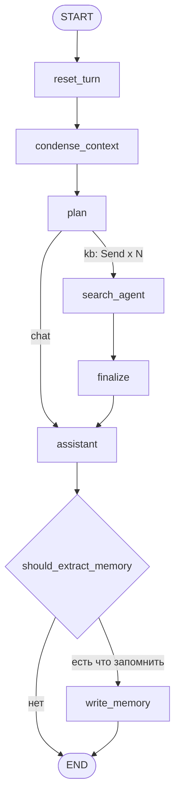

# Схема графа агента (финальная реализация)

Переработка схемы v1 по каноническим паттернам LangGraph:
`module-4/map-reduce.ipynb` (Map-Reduce), `module-4/research-assistant.ipynb`
(планировщик → `Send` → ветки → reduce), `module-4/sub-graph.ipynb`
(разделение состояний), `module-6/deployment/task_maistro.py` (роутинг).

## Структура (Map-Reduce с ReAct-ветками)



Ключевая идея — **Map-Reduce с ReAct-ветками** (как `research-assistant.ipynb` +
`sub-graph.ipynb`): планировщик разбивает запрос на подзапросы, каждая ветка —
скомпилированный ReAct-сабграф с tool `retrieve_kb` (до 2 вызовов поиска).

| Шаг | Academy (map-reduce.ipynb / research-assistant.ipynb) | Наш проект |
| --- | --- | --- |
| Планировщик | `create_analysts` + `Perspectives(BaseModel)` | `plan` + `SearchPlan` — `with_structured_output`, как `grade_chunks` в `grading.py:44` |
| Map (Send) | `continue_to_jokes` / `initiate_all_interviews` | `initiate_search_agents` — `[Send("search_agent", {"query": q, "sections": ..., "areas": ...})]` |
| Состояние ветки | `InterviewState` в research-assistant | `SearchAgentState` в `agent/search_agent.py` — ReAct-петля с `retrieve_kb` |
| Узел ветки | `conduct_interview` (сабграф) | `search_agent` (обёртка над скомпилированным сабграфом) |
| Канал накопления | `sections: Annotated[list, operator.add]` | `branch_retrieved: Annotated[list[dict], operator.add]` |
| Reduce | `write_report` / `best_joke` | `finalize` (дедуп, sort, cap, renumber, единый `sources`/`followups`) |

## Состояния

### Родительское — `AgentState` (`agent/state.py`)

```python
class SearchPlan(BaseModel):
    mode: Literal["chat", "kb"]
    subqueries: list[str] = Field(default_factory=list)

class AgentState(TypedDict):
    messages: Annotated[list, add_messages]
    summary: NotRequired[str]
    sections: NotRequired[list[str]]
    areas: NotRequired[list[str]]
    query: NotRequired[str]
    plan: NotRequired[SearchPlan]
    always_answer_with_db: NotRequired[bool]
    retrieved: NotRequired[list[dict]]                    # финальные (после finalize)
    branch_retrieved: NotRequired[Annotated[list[dict], operator.add]]  # сырой аккумулятор
    failures: NotRequired[Annotated[list[str], operator.add]]           # сбои веток
    followups: NotRequired[list[str]]
    retrieval_failed: NotRequired[bool]
    # устаревшие (удалены с графа):
    rewrite_attempts: NotRequired[int]
    needs_rewrite: NotRequired[bool]
```

### Веточное — `SearchAgentState` (`agent/search_agent.py`)

```python
class SearchAgentState(TypedDict):
    query: str
    rounds: NotRequired[int]
    sections: NotRequired[list[str]]
    areas: NotRequired[list[str]]
    retrieved: NotRequired[Annotated[list[dict], operator.add]]
    failures: NotRequired[Annotated[list[str], operator.add]]
    retrieval_failed: NotRequired[bool]
    branch_messages: Annotated[list, add_messages]   # ReAct-переписка
```

---

## Узлы и рёбра

| Узел | Роль | Что делает |
| --- | --- | --- |
| `reset_turn` | — | Сброс одноразовых полей (`plan`, `retrieved`, `branch_retrieved`, `failures`, `followups`, `retrieval_failed`) |
| `condense_context` | — | Сжатие истории (без изменений) |
| `plan` | `generate_topics` / `create_analysts` | `support_model.raw.with_structured_output(SearchPlan)` — один вызов, фолбэк `kb [query]` |
| `search_agent` | обёртка над сабграфом | Вызывает скомпилированный ReAct-сабграф (`agent/search_agent.py`), возвращает только `branch_retrieved` + `failures` |
| `finalize` | `write_report` | Fan-in: дедуп по `chunk_id`, sort по score, cap `top_k`, перенумерация `[n]`, `retrieval_failed = bool(failures) and not retrieved`, `build_followups()`, единые события `sources`/`followups` |
| `assistant` | — | Контекст из `retrieved`; при `plan.mode == "chat"` — поиск не выполнялся, сверка чисел отключена; при `retrieval_failed` — строгий текст «поиск недоступен» |
| `write_memory` | — | Без изменений |

| Рёбра | Тип |
| --- | --- |
| `plan → assistant` / `plan → search_agent×N` | **conditional edge** `initiate_search_agents`: `"assistant"` (chat) или `[Send("search_agent", {...})]` (kb) |
| `search_agent → finalize` | обычное ребро (fan-in) |
| `finalize → assistant` | обычное ребро |
| `assistant → write_memory` / `END` | conditional edge `should_extract_memory` |

---

## Что исправлено против схемы v1

1. **Планировщик — один узел со структурированным выводом.** `with_structured_output(SearchPlan)` — ровно как `create_analysts` с `Perspectives`. Единственный фолбэк: пустой `subqueries` → `kb [query]`.
2. **Веточный поиск — скомпилированный ReAct-сабграф** с tool `RetrieveQuery` (до `branch_retries+1=2` вызовов). Не простой узел, а сабграф с ReAct-петлёй (`agent/search_agent.py`).
3. **Обёртка `search_agent` вместо прямого Send в сабграф** — избегает конфликта `InvalidUpdateError` на plain-каналах (`query`, `sections`, `areas`) при параллельных ветках. Обёртка вызывает сабграф и возвращает только накопительные каналы (`branch_retrieved`, `failures`).
4. **Финализация — один узел после всех веток**. Дедуп/сортировка/кап/нумерация/единые события. Убран `rewrite_query` и коррекция — ветка сама делает до 2 вызовов (ReAct).
5. **`always_answer_with_db`** — флаг из GUI принудительно включает kb-режим, обходя планировщик.
6. **Budget контроль**: `retrieval_max_requests=10`, `retrieval_branch_retries=1` → макс. 5 подзапросов × 2 вызова = 10.

---

## Upgrade-путь

- Более сложная ветка: добавить дополнительные инструменты в `SearchAgentState` / `build_search_agent`.
- Динамический бюджет: `max_requests` может зависеть от `plan.mode` или длины вопроса.
- Логирование `search_calls` в trace для метрик eval.