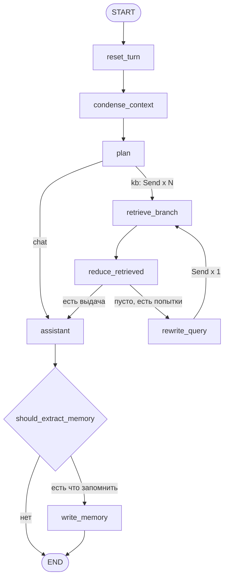

# Схема графа агента (планируемая реализация, v2)

Переработка схемы v1 по каноническим паттернам LangGraph:
`module-4/map-reduce.ipynb` (структура Map-Reduce), `module-4/research-assistant.ipynb`
(реальный кейс: планировщик → `Send` → ветки → reduce), `module-4/sub-graph.ipynb`
(разделение состояний), `module-6/deployment/task_maistro.py` (роутинг).

## Структура (одно вложение Map-Reduce)



Ключевая идея — **один канонический Map-Reduce**, как в `map-reduce.ipynb`:

| Шаг | Academy (map-reduce.ipynb) | Наш проект |
| --- | --- | --- |
| Планировщик | `generate_topics` + `Subjects(BaseModel)` | `plan` + `SearchPlan(BaseModel)` — `with_structured_output`, как `Perspectives` в research-assistant |
| Map (Send) | отдельная функция `continue_to_jokes` | отдельная функция `continue_to_retrieve` — возвращает `[Send("retrieve_branch", {"query": q})]` |
| Состояние ветки | `JokeState(TypedDict): subject: str` | `RetrieveState(TypedDict): query: str` |
| Узел ветки | `generate_joke(state: JokeState)` | `retrieve_branch(state: RetrieveState)` |
| Канал накопления | `jokes: Annotated[list, operator.add]` | `retrieved: Annotated[list[dict], operator.add]` |
| Reduce | `best_joke` | `reduce_retrieved` |

## Состояния

### Родительское — `AgentState` (agent/state.py)

```python
class SearchPlan(BaseModel):
    """Структурированный вывод планировщика — как Perspectives/Analyst в
    research-assistant.ipynb."""
    mode: Literal["chat", "kb"]
    subqueries: list[str] = Field(
        default_factory=list,
        description="независимые поисковые подзапросы для kb-режима",
    )

class AgentState(TypedDict):
    messages: Annotated[list, add_messages]

    summary: NotRequired[str]
    sections: NotRequired[list[str]]     # фильтр, виден всем веткам
    areas: NotRequired[list[str]]        # фильтр, виден всем веткам

    query: NotRequired[str]              # исходный вопрос (пишет plan, переписывает rewrite_query)
    plan: NotRequired[SearchPlan]        # вывод планировщика

    retrieved: NotRequired[Annotated[list[dict], operator.add]]  # канал накопления веток
    failures: NotRequired[Annotated[list[str], operator.add]]    # канал сбоев веток
    followups: NotRequired[list[str]]    # пишет только reduce_retrieved

    retrieval_failed: NotRequired[bool]  # финализирует reduce_retrieved из failures
    rewrite_attempts: NotRequired[int]
    needs_rewrite: NotRequired[bool]
```

### Веточное — `RetrieveState` (свой TypedDict, не общий)

```python
class RetrieveState(TypedDict):
    query: str                    # payload Send
    sections: NotRequired[list[str]]
    areas: NotRequired[list[str]]
```

Ветка получает только то, что ей нужно (`Send`-payload + общие каналы родителя) —
как `JokeState` в map-reduce.ipynb. Никаких `subquery`-полей в общем состоянии.

## Узлы и рёбра

| Узел | Роль (аналог в Academy) | Что делает |
| --- | --- | --- |
| `reset_turn` | — | Сброс одноразовых полей (`query`, `plan`, `rewrite_attempts`, `needs_rewrite`, `retrieval_failed`) |
| `condense_context` | — | Сжатие истории (без изменений) |
| `plan` | `generate_topics` / `create_analysts` | `support_model.raw.with_structured_output(SearchPlan)` (тот же механизм, что `grade_chunks` в `agent/grading.py:44`). Один вызов, без парсинга JSON |
| `retrieve_branch` | `generate_joke` | Один поиск по `state["query"]`; возврат `{"retrieved": [...]}` или `{"retrieved": [], "failures": [query]}` при `SearchUnavailable`. Не пишет `query`/`followups`, не решает про rewrite |
| `reduce_retrieved` | `best_joke` / `write_report` | Fan-in: если есть `failures` → `retrieval_failed=True`; дедуп по `chunk_id`, сортировка по score, обрезка до `retrieval_top_k`, перенумерация `[n]`; `followups`; **единые** события `sources`/`followups` |
| `rewrite_query` | — | Переписывание вопроса при пустой выдаче, `rewrite_attempts += 1` (максимум `max_rewrites`) |
| `assistant` | `write_report`-финализация | Контекст из `retrieved`; при `plan.mode == "chat"` — «поиск не выполнялся», сверка чисел отключена |
| `write_memory` | — | Без изменений |

| Рёбра | Тип |
| --- | --- |
| `plan → assistant` / `plan → retrieve_branch×N` | **conditional edge** `continue_to_retrieve`: возвращает строку `"assistant"` (chat) или список `[Send(...)]` (kb, N ≥ 1) — как `continue_to_jokes` |
| `retrieve_branch → reduce_retrieved` | обычное ребро (fan-in: reduce ждёт все ветки) |
| `reduce_retrieved → rewrite_query` / `assistant` | **conditional edge** `route_after_reduce`: `needs_rewrite` → rewrite, иначе assistant |
| `rewrite_query → retrieve_branch` | **conditional edge** `continue_after_rewrite`: `[Send("retrieve_branch", {"query": rewritten})]` — один переписанный запрос, без повторного разбиения |

## Что исправлено против схемы v1 (что было «кашей»)

1. **Планировщик-каша → один узел со структурированным выводом.** Было:
   эвристический гейт + LLM + ручной парсинг JSON + фолбэки в одном узле. Стало:
   `with_structured_output(SearchPlan)` — ровно как `create_analysts` с `Perspectives`
   в research-assistant.ipynb. Единственный фолбэк: пустой `subqueries` → один
   `Send` с исходным вопросом.
2. **Общий узел `retrieve` с режимами `subquery or query` → отдельная ветка
   с собственным состоянием.** Ветка `retrieve_branch(state: RetrieveState)` —
   как `generate_joke(state: JokeState)`, а не переиспользование узла с флагами.
3. **Свой редьюсер с дедупом в состоянии → `operator.add` + финализация в узле.**
   Состояние не занимается бизнес-логикой: `retrieved: Annotated[list, operator.add]`
   (как `jokes`/`sections`), а дедуп/сортировка/нумерация — в `reduce_retrieved`
   (как `best_joke`). OR-редьюсер для `retrieval_failed` заменён каналом
   `failures: Annotated[list, add]` — ветки только накапливают, решение — в reduce.
4. **Map-шаг — отдельная функция conditional edge**, а не логика внутри узла
   (как `continue_to_jokes` / `initiate_all_interviews`).
5. **`subquery`-поле в общем состоянии убрано** — payload живёт только в `Send`.

## Upgrade-путь (не входит в v1)

Если ветке понадобится внутренний многошаговый цикл (переписывание подзапроса
внутри ветки, ReAct с retrieve-tool) — ветку превращаем в **скомпилированный
сабграф** с собственным состоянием и `output_schema` (паттерн
`sub-graph.ipynb` + `conduct_interview` в research-assistant.ipynb); `Send`
умеет целиться в сабграф, остальной граф не меняется.